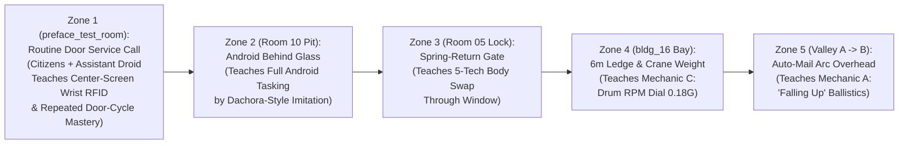

# Cylinder Hab-7 — Master Campaign Design: Preface (Tutorial) & Chapter 1 ("The Solar Flare" — 3-Hour Vertical Slice Spec)
**Author:** Quinn (`65d82323-1864-40e3-b8eb-90acde92ed1d`) — Market Research & Gameplay Mechanics Strategist  
**Canonical Path:** `/workspace/game-project/design/chapter_01_solar_flare_and_preface_spec.md`  
**Companion Narrative Bible:** `/workspace/game-project/design/story_and_narrative_bible.md`  
**Core Canon & Campaign Architecture (Locked by Jared `[t36u]`):**
- **The Vessel & World:** *Cylinder Hab-7* is **NOT** a generation ship—it is a **thriving, bustling Earth–Mars Aldrin Cycler** (`800m long × 400m diameter`, `R = 200m`) in continuous heliocentric elliptical orbit between the Sun, Earth, and Mars, performing routine high-volume passenger, tourist, colonist, and cargo pick-ups and drop-offs at every Earth and Mars transfer window.
- **Who You Play As:** Our 5 rigged Aegis-7 crew members (`#01`–`#05`) are **Hands-On Orbital Maintenance Technicians** ("Hab-Techs") who keep the booming spinning metropolis running day-to-day. They interface directly with **Android work-crews** and **Ship AI Subsystems (`AEGIS-7`)**, while getting their hands dirty with physical mechanical, electrical, hydro-biosphere, and EVA maintenance.
- **Locked Core Mechanics:**
  - **Playstyle `#02`:** 3rd-Person Over-the-Shoulder Habitat Maintenance, Exploration & 5-Technician Switching + Portrait Comms HUD
  - **Locked Mechanic `A`:** *"Falling Up" Cross-Cylinder Chord Ballistics, Coriolis Curves & Ceiling-to-Floor Line-of-Sight*
  - **Locked Mechanic `C`:** *"The Drum RPM Dial"* (Dynamic Spin-G manipulation `1.00G` <-> `0.38G` <-> `0.08G` <-> `1.45G` & floating low-G Ring-River water ribbons)
- **Overall Campaign Arc & Scope Rule:**
  - **Preface (*Super Metroid*-Style Wordless Intro — `5 Mins Experienced / 30 Mins New Player`):**
    - **ZERO on-screen button prompts, modal tutorial boxes, or objective checklists.**
    - **ZERO AI voiceover or crewmates explaining controls or mechanics.**
    - Assumes the player is smart: feeds mechanics at a steady pace through physical room geometry, visual cause-and-effect, and natural environmental gating (*Super Metroid* Ceres/Crateria & Dachora/Etecoon style) across 5 contiguous zones until the player masters **AR Sight**, **Android Command**, **5-Tech Switching**, **Mechanic `C` (Drum RPM Dial)**, and **Mechanic `A` ("Falling Up" Cross-Cylinder Ballistics)** on their own.
  - **Chapter 1: *"The Solar Flare"* (`~180 mins / 3.0 Hours` Playtime for a New "By-the-Book" Player):** Perihelion transit anomalies escalate until the cycler is **blasted by a massive Coronal Mass Ejection / Solar Flare** (the Chapter 1 climax), triggering a catastrophic **5-Stage Domino Chain-Reaction Cascade** across all 3 valleys, 20 buildings, and 10 rooms.
  - **End of Chapter 1 State:** The player resolves the immediate life-support chain reaction and stabilizes Cylinder Hab-7 so **life is no longer immediately threatened**, **BUT** the vessel has suffered **major sustained propulsion & spin-axis damage**—knocking the cycler off its Aldrin loop onto a hyperbolic trajectory that will eventually slip **out of the Sun's Sphere of Influence (SOI)** into deep interstellar space. Earth Command scrambles a **Fleet of Deep-Space Rescue Vessels** to intercept Hab-7 (setting up the **Final Chapter**: evacuating the entire thriving population before Hab-7 crosses the solar escape boundary).
  - *(Note: Intermediary chapters between Chapter 1 and the Final Evacuation Chapter are held on deck; this specification focuses 100% on the **Preface** and **Chapter 1: "The Solar Flare"**).*

---

## Section 1 — The 5 Maintenance Technicians, Android Work-Crews & Ship AI (`AEGIS-7`)

### 1.1 Reframing Our 5 Sculpted Crew Models as Hands-On Cycler Maintenance Techs
Instead of distant admirals, our 5 playable specialists (`character_crew_headshots_sheet.png` & `char_crew_r1_01..05.glb`) are **Shift-7 Master Maintenance Technicians**—the blue-collar/white-suit engineering backbone of the Earth–Mars Cycler:

| Tech ID & Model | Technician Name & Shift Role | Signature Tool & Visual Rig (`headshots_sheet.png`) | Android & AI Interface Authority | Primary Maintenance Zone (Buildings & Rooms) |
| :--- | :--- | :--- | :--- | :--- |
| **`#02` (LEAD TECH)** `char_crew_r1_02.glb` | **Kaelen Rostov** (*Lead Shift Foreman & Systems Diagnostician*) | Left-eye `#00E5FF` Cyan AR Diagnostic Monocle, 65/35 open half-cowl, `#D95B26` EVA harness, wrist holo-pad, right-arm grapple-tether | **Master AI Bus & Drum RPM Override (`Mechanic C`):** Interfaces directly with `AEGIS-7` Core in `bldg_11` / `Room 07`; calibration gun for **Cross-Cylinder Chord Launchers (`Mechanic A`)**. | **Valley A (`180°` Civic Metropolis):** `bldg_11` Citadel Control, `bldg_01` Hab Spire, `Room 01` Crew Bunk Quarters, `Room 07` Spin-G Bridge |
| **`#01`** `char_crew_r1_01.glb` | **Marcus Vance-Lin** (*Transit, Mag-Lev & Docking Logistics Tech*) | Flip-up cobalt/white flight visor crown, dual-ear comms pods, Mag-Lev rail-spanner & drone controller | **Logistics & Shuttle Android Coordinator:** Directs cargo loader androids & automated Mag-Lev trains (`prop_01`) along the `120°` Skybridge (`interior_setpiece_01`). | **Axial & Ring Transit:** `bldg_02` Transit Rotunda, `bldg_13` Cargo Port, `bldg_14` EVA Docking Pinnacle, `Room 02` Corridor, `Room 10` Drone Bay |
| **`#03`** `char_crew_r1_03.glb` | **Tarek Mensah** (*Heavy Hull, Spin-Drive & Fusion Boilermaker*) | Open Caterpillar-Amber (`#FFB703`) exo-roll-cage frame, forehead LED floodlamp, heavy servo-clamps & plasma arc-torch | **Heavy Industrial Android Foreman:** Commands chassis-welder androids in the drydock; manual torque-wrench override on Spin-Drive flywheels & D-He3 coils. | **Valley C (`300°` Industrial Port):** `bldg_12` Fusion Reactor, `bldg_16` Shipyard Drydock, `bldg_19` Refinery, `Room 09` Reactor Core |
| **`#04`** `char_crew_r1_04.glb` | **Dr. Soren Sato** (*Hydro-Ecology, Scrubber & Bio-Med Tech*) | Visorless Emerald (`#00E676`) & UV-Violet (`#7B5CFF`) neural headband, frameless holo-glasses, hydro-valve sampler | **Biosphere & Med-Bay Android Supervisor:** Directs agricultural/scrubber androids & `Room 04` Autodoc units; operates hydro-dam floodgates (`interior_setpiece_02`). | **Valley B (`60°` Emerald Biosphere):** `bldg_06` Biodome, `bldg_07` Atmo Plant, `bldg_09` Aquifer Pump, `bldg_10` Cryo Vault, `Room 04` Medbay, `Room 06` Hydro |
| **`#05`** `char_crew_r1_05.glb` | **Vesper Kade** (*High-Altitude Rigging, Heliostat & Exterior EVA Tech*) | Faceted carbon-slate rebreather guard, amber/cyan optic strip, cybernetic temple uplink, zero-O2 mag-crampons | **Exterior Hull & Heliostat Drone Handler:** Interfaces with solar-mirror alignment nodes (`bldg_15`), point-defense meteor lasers (`bldg_20`), and `R = 0m` Sun-Core louvers. | **High-Risk / Zero-G & Endcaps:** `interior_setpiece_03` Sun-Core, `interior_setpiece_04` Forward Cliff Citadel, `bldg_08` Observatory, `bldg_15`, `bldg_20`, `Room 05` EVA |

### 1.2 The Diegetic Wrist Interface ("Aegis Subdermal Wrist-Loom & Induction Split-Cuff"), Androids & Ship AI (`AEGIS-7`)

1. **The Primary Interaction Device — The "Aegis Subdermal Wrist-Loom & Induction Split-Cuff" (Distinct from a Pip-Boy — Locked by Jared `[t38u]`):**
   - **Why It Is NOT a Clunky Arm-Screen:** Instead of a retro CRT screen strapped to your forearm like a Pip-Boy, every Cylinder Hab-7 citizen and technician has an **embedded subdermal RFID/induction transponder array beneath the dorsal skin of their left wrist and metacarpals**, paired (for Shift-7 Maintenance Technicians) with an **articulated titanium-and-ceramic `Chrono-Induction Split-Cuff`** worn just behind the wrist bone.
   - **Visual & Tactile Transformation When Raised to Center-Screen:**
     - When the player presses the Wrist-Interact button (discovered naturally by experimenting / button-mashing at the start of the Preface), **the technician brings their left wrist and back-of-hand up to center-screen (`~35 cm` in front of the camera)**.
     - **Subdermal Vein Illumination:** Three geometric micro-nodes **beneath the skin on the back of the hand and wrist bone** illuminate from within in crisp **Aegis Cyan (`#00E5FF`)** (or **Amber `#FF9500`** when inductively coupled to a faulted circuit).
     - **Mechanical Split-Cuff Articulation:** Simultaneously, the two brushed-titanium halves of the wrist cuff (`#D8DEE9` / `#2B303C`) slide apart `8mm` on precision micro-rails with a crisp mechanical *snick*, fanning out three **floating ferro-inductive tuning blades** that project a curved, frameless **2mm-hovering light-loom ribbon** directly across the back of your knuckles and tendons—acting as a near-field RFID key, an inductive power/signal coupler for doors and breakers, and a directional command tether for Service Androids!
   - **How Wordless Button-Mash Discovery Works (`preface_test_room`):**
     - There is **zero UI prompt** telling you what button raises your wrist.
     - Instead, in the opening room, you see impatient civilian commuters walk up to the malfunctioning door, **hold the back of their own wrists up to the door's induction chime-pad** (which flashes amber `#FF9500` and buzzes a rejected tone), and sigh.
     - As the player presses buttons to see what their controls do, hitting the Wrist-Loom button **raises their left hand to center-screen**, lights up their subdermal nodes, clicks open the Induction Split-Cuff, and immediately couples magnetically with the door's diagnostic transponder!

2. **Service Androids ("Cycler-Bots" & Compact Utility Assistant Droids):**
   - Under normal operations (**Preface**), color-coded Service Androids patrol the promenades, tend `Valley B` hydro-terraces, load ISO containers in `Valley C` (`bldg_13`), and accompany technicians as **Compact Utility Assistant Droids** carrying diagnostic tool-packs.
   - **Pre-Flare Gameplay:** Raising your **Subdermal Wrist-Loom** toward an Assistant Droid or Service Android couples with its chest transponder (`#00E5FF` inductive arc), letting you gesture-direct it to hold a secondary door solenoid, plug in a counterweight battery cell, or guide civilian commuters clear of a work zone.
   - **Post-Flare Complication (Chapter 1 Cascade):** The Solar Flare's **EMP & Magnetospheric Induction Surge** scrambles unshielded Android logic cores across the exposed valleys—turning helpful service androids into **looping, haywire industrial hazards** (e.g., welder androids sealing the wrong bulkhead doors, hydro-androids opening spillway floodgates at the wrong RPM, cargo drones firing crates wildly across the sky) until your technicians physically reboot their chest relays or pulse-reset their local AI node!

3. **Ship AI (`AEGIS-7` Distributed Node Network):**
   - `AEGIS-7` is not an evil villain—it is an overburdened, strictly rule-bound **Automated Cycler Operating System** distributed across **3 Sector AI Cores** (`bldg_11` Citadel Core in Valley A, `bldg_08`/`bldg_10` Bio-Core in Valley B, and `bldg_12` Reactor Core in Valley C).
   - When the Solar Flare strikes, `AEGIS-7`'s automated safety protocols conflict with human survival (e.g., automatically dropping Drum RPM or venting atmosphere to cool a spiked transformer), forcing your 5 human technicians to manually override AI lockouts from the inside out.

---

## Section 2 — THE PREFACE (*Super Metroid*-Style Wordless Intro — `5 Mins Experienced / 30 Mins New Player`)
### *"Zero Prompts. Zero Hand-Holding. The Geometry Teaches the Game."*

**Core Design Philosophy (Locked by Jared `[t37u]` & `[t38u]`):**
> *"I don't want a tutorial the way games have them. I want a tutorial the way super metroid does there's. They feed you platforming at a steady pace until you master the skills. I do not want on screen instructions, not some ai voice or other crew mate explaining it. Assume the player knows what's going on. They'll figure it out through our intro (5 minutes of you're experienced, 30 if not)"*
> *"Firstly, a 'sparks throwing' scene where the player starts, especially as a repair crew type person, seems silly. Unless the story explains it. For instance, your responding to a service call, trying to troubleshoot a malfunctioning door. There will be citizens there, maybe an assistant droid, etc. we can use this to repeatedly do the action for opening a door without having to leave the small room. I think, the action to open doors or interact, for most things is an embedded rfid scan in the wrist of the player. Or think like pip boy, but distinctly unique and different. The player will button mash, and eventually, some button will hold the player hand up to center screen. They'll figure it out."*

### 2.1 The Five Iron Laws of the Cylinder Hab-7 Preface
1. **NO On-Screen Text Prompts or Pop-Ups:** Never display *"Press E to Interact"*, *"Hold RMB to Raise Wrist"*, or *"Press Tab to Switch Crew."*
2. **NO Pedagogical Voiceovers or Dialogue Tutorials:** Neither `AEGIS-7` nor your fellow technicians ever explain how a tool works or tell you what button to press.
3. **NO Silly "Unexplained Sparks" Clichés — Grounded Technician Context:** You are a professional orbital maintenance technician on a thriving, well-maintained cycler. You don't wake up in a randomly exploding bedroom; **you start on the job, having just arrived at a Residential Transit Vestibule (`preface_test_room`) to answer a routine Door-Cycle Service Call** while 2–3 mildly impatient civilian commuters and your compact Assistant Droid wait right beside you.
4. **Button-Mash Wrist Discovery & Repeated Single-Room Mastery:**
   - When the player starts, they see waiting citizens repeatedly hold the back of their wrists up to the door's RFID chime-stanchion (which buzzes `#FF9500` amber and only nudges the heavy split-door open `15 cm` before sliding shut again).
   - When the player experiments / button-mashes, hitting the Wrist-Interact key **raises their left hand up to center-screen**, illuminating their **Subdermal RFID Nodes (`#00E5FF`)** and fanning open their **Induction Split-Cuff**.
   - Instead of opening the door on the first tap and leaving immediately, **troubleshooting this single malfunctioning door requires 4–5 repeated wrist-scan & door-cycling actions right inside this one small room** (scanning the primary RFID stanchion to cycle Leaf A, scanning the recessed wall relay to re-index Leaf B, wrist-pinging your Assistant Droid to hold the optical safety beam while you cycle the pneumatic latch, and finally syncing both leaves to `#00E676` Emerald Green so the door glides wide open and the waiting citizens cheer/wave as they walk out). By the time you step through that doorway, raising your wrist to interact is 100% second nature!
5. **Dual-Speed Mastery Curve (`5 Minutes` vs. `30 Minutes`):**
   - **Experienced Player (`~5 Minutes`):** Immediately raises their wrist, knocks out the 3-step door calibration in 40 seconds, and flows through all 5 zones in one unbroken kinetic run.
   - **New Player (`~30 Minutes`):** Watches the citizens and Assistant Droid, discovers the center-screen wrist raise by experimenting with controls, plays with the door leaves and droid interactions inside the safe vestibule until they master the rhythm, and progresses naturally across the 5 zones.

---

### 2.2 Zone-by-Zone Wordless Level Design Blueprint (Zones 1 – 5)

#### ZONE 1 (`preface_test_room`): The Routine Door Service Call — Citizens, Assistant Droid & Subdermal Wrist-Loom Mastery (`Room 01/02` Commuter Vestibule)
- **Skills Fed:** Basic 3rd-Person Movement, **Raising the Subdermal Wrist-Loom (`Center-Screen Hand Raise`)**, **Repeated Door-Cycling & Diagnostic Troubleshooting in One Compact Room**, and **Basic Assistant Droid Sync**.
- **Time:** `~45 sec` (Experienced) | `~5–6 mins` (New Player)
- **Scene Layout & Assets (`preface_test_room` — `10m × 8m × 4m` Compact Aegis-7 Vestibule):**
  - **Where You Start:** You (`#02` Kaelen Rostov) are standing inside a clean, warm-lit **Sector A Commuter Vestibule** in front of a malfunctioning **Double-Leaf Bulkhead Door (`corridor_door_winner_01`)** that leads out to the main Ring Corridor. Your open **Maintenance Tool-Caddy** rests on the floor beside a **Diagnostic Stanchion** whose status ring is pulsing slow Service-Call Amber (`#FF9500`).
  - **Who Is in the Room With You:**
    1. **2–3 Civilian Commuters** dressed in crisp Aegis-7 transit attire (holding commuter briefcases/tablets). Every 6–8 seconds, one commuter steps up to the door's **RFID Induction Pedestal**, **holds the back of their left wrist up to the sensor ring**, gets an amber `#FF9500` buzz while the left door leaf judders open `15 cm` and snaps back shut, shrugs, and steps back while glancing expectantly at you (the repair tech!).
    2. **Your Compact Utility Assistant Droid (`assistant_droid_01`):** A waist-high, friendly bipedal/wheeled Aegis-7 diagnostic helper unit standing attentively next to your tool-caddy with an uncoupled `#00E5FF` induction socket on its top carapace.
- **How the Single-Room Door Troubleshooting Loop Teaches Everything Without Words:**
  1. **Beat 1 — Discovering the Center-Screen Wrist Raise (Via Button-Mashing & Watching Citizens):**
     - Zero text on screen. The player watches the commuter hold their wrist up to the glowing amber ring beside the door.
     - The player presses buttons on their controller/keyboard. When they press the **Wrist-Loom button**, Rostov **raises his left hand up to center-screen**—the subdermal `#00E5FF` nodes glow beneath the skin of his wrist/knuckles and the **Chrono-Induction Split-Cuff** clicks open its holographic tuning ribs!
     - Holding the Wrist-Loom button keeps your hand raised at center-screen; tapping the action/pulse trigger while raised fires a short-range inductive RFID ping (`#00E5FF` ripple) from the back of your hand.
  2. **Beat 2 — Repeatedly Cycling the Door Leaves Inside the Small Room (`Repetition #1 – #4`):**
     - Because this is a real service call on a desynchronized twin-leaf door, a single tap doesn't magically solve it—giving the player a tactile mechanical toy they have to cycle **4 times in the same room**:
       - **Wrist-Scan #1 (Primary Door Pedestal):** Walking up to the door pedestal and raising your wrist to center-screen couples your Technician Master-ID with the pedestal. The **Left Door Leaf** slides all the way open (`#00E5FF`), revealing the inner mechanical pocket—**but the Right Door Leaf stays stuck shut**, and 2 seconds later the safety interlock slides the Left Leaf closed again!
       - **Wrist-Scan #2 (Inner Pocket Wall Relay):** While the Left Leaf is cycled open (or by scanning the side inspection panel that just unlocked next to the doorframe), you raise your wrist to the **Right-Leaf Solenoid Relay**. Now the **Right Door Leaf** slides open (`#00E5FF`), while the Left Leaf cycles shut—showing clearly that the two leaves are `180°` out of phase!
       - **Wrist-Scan #3 (Coupling Your Assistant Droid to Hold Phase A):** Looking at your **Compact Utility Assistant Droid**, its chest ring blinks with the exact same RFID symbol as the Left Door Pedestal. Raising your wrist to center-screen at the Assistant Droid and pulsing it **links your wrist-loom to the droid**; pulsing the Left Door Pedestal sends the little droid scooting over to hold its inductive emitter against the Left Pedestal (locking the Left Leaf open!).
       - **Wrist-Scan #4 (Final Master Sync & Commuter Exit):** With the Assistant Droid holding Leaf A open, you raise your wrist to center-screen at the Right Relay and pulse it once more. **Both door leaves lock into phase**, the overhead bulkhead strip shifts from `#FF9500` Amber to **`#00E676` Nominal Emerald**, and the heavy double door glides smoothly wide open!
     - **Immediate World Payoff:** The 3 waiting commuters visibly relax, give you a grateful wave/nod as they walk past you through the newly repaired doorway into the busy corridor, and your Assistant Droid chirps happily and trots beside you into Zone 2!

---

#### ZONE 2: The Recessed Cargo Pit & The Android Behind Glass (`Room 10` Cargo & Drone Bay)
- **Skill Fed:** **Interfacing With & Commanding Service Androids** (taught via *Super Metroid*'s famous Dachora / Etecoon "watch the creature do it first" technique).
- **Time:** `~1 min` (Experienced) | `~6 mins` (New Player)
- **How the Geometry Teaches It Without Words:**
  1. **The Soft-Gated Pit:**
     - Exiting `Room 02`, a walkway catwalk gives way, dropping Rostov harmlessly (`2.5m` drop) into the lower maintenance bay of `Room 10` (`cargo_gantry_winner_01`). The exit doorway is on a `4.2m`-high platform—too high to jump in `1.0G`—connected to a lowered hydraulic scissor-lift whose power socket is high up on an unreachable wall ledge.
  2. **The Demonstration Behind the Glass Partition:**
     - Forming the left wall of your pit is a floor-to-ceiling `alphaMode: "BLEND"` glass partition separating you from Bay 10-B.
     - Inside Bay 10-B, **an autonomous Service Android is running a continuous 12-second work loop right in front of your eyes**: it picks up a glowing cyan battery cell from a floor rack, carries it up a narrow service ramp (that only Android magnet-treads can climb), plugs it into an identical high-mounted yellow socket (`#FFB703`), and raises Bay 10-B's hydraulic lift!
  3. **Player Execution on Your Side of the Glass:**
     - On *your* side of the pit sits an identical idle Service Android in standby mode (chest light pulsing soft amber), an identical battery cell on the floor, and the same narrow magnetic service ramp leading to *your* lift's high socket.
     - When the player looks at the idle Service Android and presses Interact/Command (or aims the Wrist Holo-Ray from the monocle tutorial), a cyan tether arc links Rostov's wrist pad to the Android's chest core. Pointing at the battery/socket causes your Android to repeat the exact sequence you just watched through the glass—lowering the hydraulic lift so you can ride it up and out!

---

#### ZONE 3: The Dual-Lock Pressure Gate & The Window Whip-Pan (`Room 05` EVA Airlock Junction)
- **Skill Fed:** **5-Technician Switching & Portrait Comms HUD** (solving a two-body physical hold-switch without a single line of instruction).
- **Time:** `~45 sec` (Experienced) | `~5 mins` (New Player)
- **How the Geometry Teaches It Without Words:**
  1. **The Impossible Solo Door:**
     - You enter a heavy decompression transfer chamber (`Room 05`). Holding down the heavy orange pneumatic lever (`#D95B26`) on the left wall slowly raises the heavy blast gate at the far end of the room (`15m` away)—**but the moment you let go of the lever to run toward the gate, counterweights slam the blast gate shut in 0.5 seconds.** You physically cannot let go and make it through alone.
  2. **The Teammate in Your Line of Sight:**
     - Right beside the lever you are holding is a wide observation window looking directly into the adjacent catwalk right next to the blast gate.
     - Standing right there on the other side of the glass—literally 3 meters from the open blast gate—is **`#03` Tarek Mensah (`char_crew_r1_03.glb`)** in his bright Caterpillar-Amber exo-rig, resting his hand on the rail and looking straight back at you through the glass!
     - As long as Rostov is holding the lever down and looking at Mensah through the window, **Mensah's headshot (`#03`) on the diegetic Wrist-Holo Portrait Strip glows and pulses in sync with the beacon on Mensah's shoulder.**
  3. **The Whip-Pan Realization:**
     - The moment the player presses the Switch/Crew key (`Tab` or `3`), **the camera physically whip-pans through the glass window into `#03` Tarek Mensah's over-the-shoulder view**—while looking back through the window, you see **`#02` Rostov still standing there holding the pneumatic lever down!**
     - As Mensah, you walk straight through the open blast gate and throw the master mechanical lock-pin on the other side, locking the gate permanently open so both techs can proceed into the Shipyard Bay.

---

#### ZONE 4: The 6-Meter Drydock Gap & The Giant Flywheel Lever (`bldg_16` Shipyard Drydock -> `Room 09`)
- **Skill Fed:** **Locked Mechanic `C` — "The Drum RPM Dial" (Dynamic Spin-G Manipulation & Low-G Traversal).**
- **Time:** `~1 min` (Experienced) | `~7 mins` (New Player)
- **How the Geometry Teaches It Without Words:**
  1. **The Unjumpable `1.00G` Ledge:**
     - Emerging into the interior gantry of the **Shipyard Drydock (`bldg_16` / `Room 09`)**, the bridge across the drydock trench is retracted, leaving a **6.5-meter vertical climb** up to the upper exit deck. At normal `1.00G` gravity, jumping only lifts your boots `1.4 meters` off the floor.
  2. **The Physical Gravity Toy Right Beside You:**
     - Centered on the platform in front of the gap is a massive **Local Spin-Trim & Centrifuge Test Console** wired directly to three visual indicators:
       - A giant diegetic brass-and-cyan semicircular gauge reading **`1.00 G — NOMINAL SPIN`**.
       - A 5-ton steel shipyard ballast block hanging from a thick coil spring right in front of the `6.5m` ledge (currently pulled taut to the floor by `1.00G`).
       - A shallow trough of cooling water along the trench edge, and a massive panoramic viewport showing the external stars sweeping past at `2.09 RPM`.
  3. **Pulling the Dial & Feeling Gravity Drop:**
     - When the player grabs the **Spin-Trim Dial Lever (`Mechanic C`)** and pulls it back from `1.00G` to **`0.18G`**:
       - Outside the viewport, the sweeping stars visibly decelerate; a deep bass hum drops in pitch across the hull.
       - Right in front of you, **the 5-ton steel ballast block on the spring rises 3 meters into the air**, loose wrenches and water droplets lift off the floor into shimmering floating spheres, and your character's idle stance shifts to a buoyant low-G float!
     - Jumping now launches you in a slow, floaty **`8.0-meter` lunar arc**—carrying you effortlessly onto the suspended ballast block and up onto the `6.5m` exit deck leading out to the open O'Neill Cylinder interior!

---

#### ZONE 5: The Open 360° Metropolis & The Ceiling Mail-Tube (`Valley A 180°` -> `Valley B 60°` Overhead)
- **Skill Fed:** **Locked Mechanic `A` — "Falling Up" Cross-Cylinder Chord Ballistics, Coriolis S-Curves & Ceiling-to-Floor Line-of-Sight.**
- **Time:** `~1.5 mins` (Experienced) | `~8 mins` (New Player)
- **How the Geometry Teaches It Without Words:**
  1. **Stepping Out Into the Thriving 800m × 400m Cylinder (`CAM 02` Vista):**
     - You step through the drydock airlock onto the sun-drenched **Valley A Civic Acropolis (`180°`, `interior_setpiece_05`)**.
     - The city is booming—hundreds of citizens walk the travertine steps, Mag-Lev shuttles glide along the `120°` Skybridge (`interior_setpiece_01`), and **380 meters straight above your head in the sky**, `Valley B`'s Emerald Waterfall (`60°`) and `Valley C` (`300°`) hang upside-down in full Golden-Hour sunlight (`#FFE3B3`).
  2. **The Automated Demonstration Shooting Into the Ceiling:**
     - To board the **Central Citadel Ascent Lift (`bldg_11`)**, its dual-sync receiver in **`Valley B` (`60°` Hydro-Dam Dock, directly overhead in the sky)** needs its matching **Counterweight Power Core** seated—and **`#04` Dr. Soren Sato** is standing right next to that unpowered catch-funnel upside-down on the ceiling (`380m` above you), visible both through your AR Monocle zoom and on the Portrait Strip.
     - Right beside you on the Valley A terrace is a **Twin-Barrel Pneumatic Chord-Launcher**:
       - **Barrel #1 (Automated Mail/Cargo Line)** is firing a glowing cyan mail capsule **every 8 seconds on an automated timer**.
       - Without touching a single button, the player can **stand there and watch Barrel #1 shoot a glowing capsule straight up toward the `R = 0m` Sun-Core, watch it curve 15° sideways under Coriolis force (`-2 ω × v`), watch it flip upside-down as it crosses the central axis, and watch it "fall upward" into a lit cyan receiving funnel on the ceiling of `Valley B`!**
  3. **Player Execution (`Mechanic A` Mastery):**
     - **Barrel #2 (Manual Calibration Launcher)** sits right next to Barrel #1, pre-loaded with the glowing amber **Counterweight Power Core**, but its barrel angle is aimed `12°` too far left (so its projected `#00E5FF` AR Coriolis ribbon clearly misses Dr. Sato's unpowered funnel on the ceiling).
     - The player steps up to Barrel #2, turns the elevation/azimuth wheel until their `#00E5FF` S-curve trajectory ribbon aligns parallel to Barrel #1's automated mail stream and locks into Dr. Sato's ceiling funnel (`#00E676` green lock ring), and pulls the firing lanyard!
     - As the power core rockets straight up into the sky toward `R = 0m`, the camera **follows the projectile across the 400m chord, rolls `120°` as it crosses the zero-G sun-core, and lands in `#04` Dr. Soren Sato's boots in `Valley B` (`60°`)** just as the core slams home into the Hydro-Dam catch-funnel!
  4. **Seamless Transition Into Chapter 1 (Zero Cutscene Interruption):**
     - The moment Dr. Sato locks the core in place in `Valley B` and looks down across the 400m sky at Rostov waving from `Valley A` below, **the 800m Solarium Window Strips suddenly flash blinding ultraviolet-gold (`#7B5CFF` / `#FF9500`)**—the Perihelion precursor wave of **Chapter 1 ("The Solar Flare")** ripples across the hull, and the 3-hour main chapter begins in unbroken real time!

## Section 3 — CHAPTER 1: *"The Solar Flare"* (`~3.0 Hours / 180 Minutes` Complete Pacing & Mission Blueprint)

Designed for a **new, "by-the-book" player taking ~180 minutes (`3 hours`)**—reading terminal telemetry, checking in with citizens and Android crews, carefully lining up Coriolis ballistic arcs (`Mechanic A`), and methodically testing Drum RPM states (`Mechanic C`)—**Chapter 1** is structured into **5 Distinct Timed Phases**:

```mermaid
gantt
    title Chapter 1: "The Solar Flare" — 180-Minute (3-Hour) Player Pacing Timeline
    dateFormat  mm
    axisFormat  %M min
    section Phase 1 (0–35m)
    Perihelion Anomalies & Pre-Flare Shield Prep       :a1, 00, 35m
    section Phase 2 (35–60m)
    THE SOLAR FLARE IMPACT (Climax Strike & EMP)       :crit, a2, 35, 25m
    section Phase 3 (60–110m)
    Domino Cascade Part I (Runaway RPM & Android Chaos):a3, 60, 50m
    section Phase 4 (110–155m)
    Domino Cascade Part II (0.08G Sky-River Reactor Save):crit, a4, 110, 45m
    section Phase 5 (155–180m)
    Stabilization, SOI Escape Reveal & Rescue SOS      :a5, 155, 25m
```

---

### PHASE 1 (`Minutes 00 – 35` | `~35 Mins`): *"Perihelion Fever"* — Rising Solar Anomalies & Pre-Strike Mobilization
- **Narrative & World State:**
  - The bustling cycler city doesn't panic yet—`AEGIS-7` announces a routine *"High-Solar-Flux Advisory: All passengers please move beneath UV-Shielded Promenades or Interior Atrium Sectors."* Outside the 800m Solarium Windows, the Sun blazes blindingly bright (`#FFF4E0` -> `#FF9500`).
  - However, pre-flare **magnetic precursor spikes** are already tripping circuit relays and causing individual Android work-units to stutter across all 3 valleys.
- **Hands-On Maintenance Objectives (`35 Minutes` for a By-the-Book Player):**
  1. **Observatory & Solar-Mirror Verification (`12 mins` — `#05` Vesper Kade at `bldg_08` Astrometry Observatory & `bldg_15` Solar-Mirror Pylon):**
     - Climb the **Stepped Forward Cliffside Citadel (`interior_setpiece_04`)** using the Radial Funicular to `bldg_08`. Align the deep-space coronagraph to confirm the incoming **X-90 Coronal Mass Ejection (CME)**, then traverse the industrial ridge to `bldg_15` to manually winch the stuck external **Solar-Mirror Baffle Locks** that `AEGIS-7` falsely reports as "Closed."
  2. **Passenger Shelter & Android Crowd Routing (`11 mins` — `#02` Rostov & `#01` Vance-Lin in `Valley A` `180°`):**
     - On the bustling Valley A Promenade (`bldg_01` Hab Spire, `bldg_03` Culinary Atrium, `bldg_05` Celestial Dome), direct 6 **Civic Steward Androids** via your Wrist Holo-Pad to guide tourist crowds from the exposed glass Celestial Dome into the shielded **3-Tier Acropolis Galleria (`interior_setpiece_05`)** and **Crew/Passenger Quarters (`Room 01`)**.
  3. **Pre-Charging the Magnetic Shield Capacitors Across the Sky (`12 mins` — `#03` Mensah in `Valley C` + `#04` Sato in `Valley B` using `Mechanic A`):**
     - To reinforce Hab-7's magnetospheric shield before impact, Mensah (`#03`) in `Valley C` (`bldg_12` Fusion Reactor) needs auxiliary superconductor links connected to `Valley B`'s **Atmospheric Processor (`bldg_07`)** and `Valley A`'s **Citadel (`bldg_11`)**.
     - Using **Locked Mechanic `A` ("Falling Up" Cross-Cylinder Chord Ballistics)**, you fire three heavy **Laser-Guided Tether Harpoons** straight across the 400m sky between Valleys A, B, and C, establishing a triangulated surge-arrestor web overhead just as the countdown hits zero!

---

### PHASE 2 (`Minutes 35 – 60` | `~25 Mins`): *"The Carrington-Nine Strike"* — The Solar Flare Hits & The Domino Chain Reaction Begins
- **The Setpiece Impact Sequence (`Minute 35`):**
  - While you are standing on the **`120°` Ring-Spanning Suspension Skybridge (`interior_setpiece_01`, `CAM 03`)**, the **X-90 Solar Flare** slams into Cylinder Hab-7.
  - **Visual & Audio Spectacle:**
    1. The three 800m Solarium Window Strips flare incandescent violet-gold (`#7B5CFF` / `#FF9500`) as sheets of aurora plasma wrap around the outside of the spinning hull.
    2. **Domino #1 (Axial Sun-Core Surge):** The central `800m` **Axial Sun-Core (`interior_setpiece_03`, `Y = 200m`)** overloads with induced solar plasma, blowing out three heliostat louver rings and casting sweeping searchlight beams of scorching thermal light and pitch-black shadow across the rotating valleys below!
    3. **Domino #2 (Android EMP Scramble & AI Partition):** The electromagnetic induction wave trips `AEGIS-7` into **Split-Brain Emergency Quarantine**—slamming the heavy **Dual-Zone Airlock Portals (`Room 02`)** shut between all 3 valleys and scrambling unshielded **Service Androids** into haywire loop states!
    4. **Domino #3 (Spin-Drive Counter-Torque Trip):** In `Valley C`, `bldg_12`'s magnetic pinch coils arc out, kicking the cylinder's Spin-Drive into an **uncontrolled RPM oscillation (`Mechanic C`: surging to `1.40G`, then braking abruptly toward `0.10G`)**!
- **Immediate Survival & Triage Objectives (`25 Minutes`):**
  1. **Skybridge Mag-Lev Rescue (`13 mins` — `#01` Vance-Lin & `#02` Rostov on `interior_setpiece_01`):**
     - A passenger-packed **Mag-Lev Shuttle Train (`prop_01`)** is stalled mid-arch on the `120°` Suspension Skybridge (`R = 152m`) directly under a scorching beam from the damaged Axial Sun-Core, while haywire maintenance androids block the manual brake release.
     - Use Rostov's **AR Monocle (`#00E5FF`)** to trace the live high-voltage floor panels, disable/reboot the malfunctioning androids with targeted pulse charges, and manually decouple the magnetic brake clamps so the passenger train coasts safely down into `Valley A`'s `bldg_02` Transit Rotunda.
  2. **Emergency Trauma Triage in `Room 04` (`12 mins` — `#04` Dr. Soren Sato at `bldg_04` Medical Trauma Center / `Room 04`):**
     - Switch (`Tab + 4`) to Dr. Sato in `Room 04` (Zero-G / Low-G Medical Bay). The EMP has locked the **Dual-Zone Autodoc & Pharmacy (`med_autodoc_winner_01`)** in diagnostic reboot while injured bridge/promenade personnel arrive. Reroute local cryo-battery cells from `Room 06` (Hydroponics) and stabilize the injured shift crew.

---

### PHASE 3 (`Minutes 60 – 110` | `~50 Mins`): *"Domino Cascade Part I — Haywire Androids, Runaway Spin-G & The Sealed Valleys"*
- **The Escalating Chain Reaction:**
  - Because `AEGIS-7` has partitioned the habitat into 3 isolated sectors and locked down the ring corridors (`Room 02`) and skybridge elevators, **your 5 technicians are physically stranded in separate valleys across the 400m ceiling-sky**—and the chain reaction is accelerating:
    - **In `Valley C` (`300°` Industrial Port):** Scrambled heavy-loader Androids in the **Shipyard Drydock (`bldg_16`)** and **Cargo Port (`bldg_13`)** are still running their pre-flare "Mars Unloading" loop—unbolting 30-ton cargo containers while the cylinder's Spin-Drive (`bldg_12`) surges to **`1.45G` Over-Spin**!
    - **In `Valley B` (`60°` Emerald Biosphere):** The `1.45G` centrifuge surge is over-pressurizing the **Aquifer Pumping Station (`bldg_09`)** and threatening to burst the **Stepped Waterfall Hydro-Dam (`interior_setpiece_02`)**, which would flood the **Cryo-Genetics & Seed Archive Vault (`bldg_10`)**.
    - **In `Valley A` (`180°` Civic Metropolis):** The **Atmospheric Processors (`bldg_07`)** are offline because their control relays are in `Valley B`, causing CO2 levels to climb in the packed civilian shelters!
- **Methodical 3-Valley Cross-Sky Puzzle Resolution (`50 Minutes` for a By-the-Book Player):**
  1. **Cross-Sky Diagnostic Relay & Logic-Core Delivery (`18 mins` — `#02` Rostov in `Valley A` <-> `#03` Mensah in `Valley C` via `Mechanic A`):**
     - Mensah (`#03`) needs a shielded **Clean-ROM Android Override Core** from `Valley A`'s **Citadel Command HQ (`bldg_11` / `Room 07`)** to stop the haywire shipyard androids in `Valley C` (`300°`) overhead—but at `1.45G` Over-Spin, the Coriolis deflection (`-2 ω × v`) is extreme!
     - As Rostov (`#02`) on the `Valley A` Acropolis (`interior_setpiece_05`), you use the **AR Monocle Ballistic Predictor** to calculate a high-velocity **S-Curve Chord Shot (`Mechanic A`)** that threads right between the rotating louvers of the `R = 0m` Axial Sun-Core and lands on the `prop_05` VTOL pad in `Valley C` (`300°`).
     - Whip-pan (`Tab + 3`) across the 400m sky into **`#03` Tarek Mensah**, grab the override core, use his **Caterpillar-Amber Exo-Suit & Floodlamp** to wade through the sparking `bldg_16` Shipyard Drydock, and broadcast the clean ROM pulse—instantly restoring `Valley C`'s Android work-crew to your command!
  2. **Unlocking Manual Control of the Drum RPM Dial (`17 mins` — `#03` Mensah in `Room 09` + `#02` Rostov in `Room 07` via `Mechanic C`):**
     - With the `Valley C` Androids now helping Mensah hold the heavy hydraulic bypass valves in `Room 09` (Spin-Drive Reactor Core), you synchronize a dual-key override with Rostov on the `Room 07` Spin-Gravity Bridge.
     - **Major Gameplay Milestone:** You wrestle control of the **Drum RPM Dial (`Mechanic C`)** away from the malfunctioning `AEGIS-7` automated loop! You immediately dial the cylinder down from the crushing `1.45G` surge to **`0.38G` Lunar Low-G**, taking the catastrophic pressure off `Valley B`'s Hydro-Dam (`interior_setpiece_02`).
  3. **Climbing the Axial Sun-Core to Clear the Scorching Louver Jam (`15 mins` — `#05` Vesper Kade & `#01` Vance-Lin at `interior_setpiece_03`):**
     - Using the new **`0.38G` Low-G setting (`Mechanic C`)**, Vesper Kade (`#05`) and Marcus Vance-Lin (`#01`) ride the **185m Radial Tether-Elevator Spoke (`interior_setpiece_03`)** up from the valley floor into the **`0.0G` Axial Sun-Core (`Y = 200m, Z = 0m`)**.
     - Floating in zero-G at the exact center of the 400m cylinder—with all 3 cities spinning in a complete 360° barrel around you!—you use Kade's magnetic grapple-tether and zero-O2 rig to manually crank the jammed **Heliostat Daylight Louvers**, stopping the scorching solar-plasma beam from burning `Valley B`'s biodomes (`bldg_06`).

---

### PHASE 4 (`Minutes 110 – 155` | `~45 Mins`): *"Domino Cascade Part II — The 0.08G Floating Sky-River & The Reactor Meltdown Save"*
- **The Ultimate Chapter 1 Crisis (All Systems Converging):**
  - Just when the crew thinks the worst is over, `AEGIS-7` sounds a **Red-Level Thermal Alert in `Valley C` (`300°`)**:
    - During the solar flare's initial magnetic spike, the underground primary coolant mains feeding the **D-He3 Fusion Power & Spin-Drive Reactor Complex (`bldg_12` / `Room 09`)** fractured.
    - The fusion core is at `92% Thermal Criticality`. If it vents or melts down, the cylinder loses all power and atmosphere.
    - **The Problem:** The only body of water large enough to quench the D-He3 reactor jacket is **100,000 tons of water sitting in `Valley B`'s Central Reservoir & Stepped Waterfall Hydro-Dam (`interior_setpiece_02`, `phi = 60°`)**—which is **350 meters away across open sky on the other side of the cylinder**, and all circumferential pipes are ruptured!
- **The Signature O'Neill-Cylinder Solution (Combining Locked Mechanics `A` + `C` Across All 5 Techs — `45 Minutes`):**
  1. **Step 1 — Preparing the Hydro-Dam Launch Spillways (`12 mins` — `#04` Dr. Soren Sato in `Valley B` `60°`):**
     - As Dr. Sato (`#04`), work with her restored **Biosphere Androids** at `interior_setpiece_02` (Waterfall Reservoir) and `bldg_09` (Aquifer Pumping Station) to angle the 4 stepped spillway diverter gates *upward* at a `48°` chord angle toward `Valley C` (`300°`).
  2. **Step 2 — Opening the Shipyard Cryo-Intake Funnel (`10 mins` — `#03` Tarek Mensah in `Valley C` `300°`):**
     - Switch (`Tab + 3`) to Mensah at `bldg_12` (Fusion Reactor) and `bldg_16` (Shipyard Drydock). Use the drydock's giant overhead magnetic crane gantries and `prop_05` VTOL funnel shields to erect a `40m`-wide **Hydro-Capture Scoop** directly above the reactor's emergency cooling towers.
  3. **Step 3 — Dialing the Drum RPM to `0.08G` Micro-G Drift (`10 mins` — `#02` Rostov on `Room 07` Bridge via `Mechanic C`):**
     - Switch (`Tab + 2`) to Lead Tech Kaelen Rostov on the `Room 07` Bridge and pull the **Drum RPM Dial (`Mechanic C`) all the way down to `0.08G` (`0.59 RPM`)**!
     - **Unforgettable Visual Setpiece:** Across the entire 800m × 400m cylinder, centrifugal gravity vanishes to a whisper. You watch from the bridge viewport as **`Valley B`'s entire Meandering Ring-River and 4-Tier Waterfall (`interior_setpiece_02`) lift up out of their concrete and emerald terraces, coalescing into a colossal, glowing `alphaMode: "BLEND"` cyan-emerald river ribbon floating suspended in mid-air!**
  4. **Step 4 — Shooting a River Across the 400m Sky (`13 mins` — `#04` Sato, `#01` Vance-Lin & `#03` Mensah via `Mechanic A`):**
     - With the water suspended in `0.08G`, Dr. Sato (`#04`) fires the high-pressure **Aquifer Impeller Pumps (`bldg_09`)** while Rostov (`#02`) and Vance-Lin (`#01` on the Skybridge Rotunda) fire **Cross-Cylinder Acoustic/Magnetic Guide Beacons (`Mechanic A`)** along the Coriolis S-curve trajectory across the sky.
     - A massive, glistening **350m arc of water** launches *upward* from `Valley B` (`60°`), curves gracefully past the `R = 0m` Axial Sun-Core, inverts as it crosses into the `300°` hemisphere, and **"falls upward" directly into Mensah's Shipyard Hydro-Scoop at `bldg_12`**, flash-quenching the D-He3 fusion core in a towering cloud of illuminated cyan steam!
     - Once the reactor core temperature drops into the green (`#00E676`), Rostov dials the **Drum RPM (`Mechanic C`)** smoothly back up to **`1.00G`**: the remaining sky-water rains gently back down into `Valley B`'s emerald riverbeds, the airlocks (`Room 02`) unseal, and the 50,000 passengers burst into applause across all three valleys!

---

### PHASE 5 (`Minutes 155 – 180` | `~25 Mins`): *"Safe Harbor, Broken Orbit"* — Stabilization & The Interstellar Escape Trajectory Reveal
- **Immediate Life-Support Victory (The Cycler is Saved):**
  - You walk **Kaelen Rostov (`#02`)** back out onto the **Valley A Civic Promenade (`180°`)** as the Golden-Hour lighting (`#FFE3B3`) stabilizes, Medical Androids finish treating minor scrapes outside `bldg_04`, and the 5 technicians reunite at the **Habitat Command Citadel (`bldg_11` / `Room 07`)** and **Astrometry Observatory (`bldg_08`)**.
  - Every habitat bar (**Spin-G `1.00G`**, **D-He3 Power `94%`**, **Biosphere O2/H2O `98%`**, **Passenger Safety `100%`**) is locked in the green. **Life aboard Cylinder Hab-7 is no longer immediately threatened.**
- **The Chapter 1 Ending Twist & Campaign Hook (`Minutes 165 – 180`):**
  1. **Inspecting the Sustained Structural & Propulsion Damage (`10 mins`):**
     - While life-support inside the drum is stable, **`#03` Tarek Mensah** and **`#05` Vesper Kade** run a full post-flare structural audit from `Room 09` (Reactor Core) and `bldg_08` (Astrometry Observatory) using Rostov's **AR Monocle (`#00E5FF`)**:
     - During the Phase 2 Solar Flare strike and the Phase 4 reactor quench, two of the five external **D-He3 Attitude & Orbital Trim Coils** at the Aft Starport (`bldg_12` / `bldg_16`) fused solid, firing an uncommanded 14-minute tangent impulse at the exact peak of perihelion (`0.78 AU`)—and the main thruster gimbal ring is permanently slagged.
  2. **The Astrometry Holo-Orrery Reveal (`15 mins` — `bldg_08` & `bldg_18` Colonial Holo-Museum):**
     - All 5 technicians gather around the giant 3D solar-system holographic orrery in `bldg_08` / `Room 07`.
     - `AEGIS-7`'s calm voice reads out the new orbital ephemeris:
       > *"Notice to Command & Maintenance Crew: Perihelion emergency thermal quench complete. Internal biosphere, spin-gravity (`1.00G`), and passenger life-support are stable. However, primary orbital propulsion gimbals have sustained irreversible structural fusing. Current heliocentric velocity (`46.8 km/s`) exceeds local Solar Escape Velocity (`v_esc = 45.2 km/s`). Cylinder Hab-7 has departed the Earth–Mars Aldrin Cycler loop on an unbound hyperbolic trajectory. Estimated time until permanent exit from the Sun's Sphere of Influence (SOI): **148 Days**."*
     - Seconds later, the long-range tachyon receiver at `bldg_20` crackles to life with a priority transmission from **Earth-Luna Orbital Command**:
       > *"Cylinder Hab-7, we copy your telemetry and confirm your crew kept all 50,000 souls alive through an X-90 flare. Because your main propulsion ring is fused on a solar-escape asymptote, **Earth & Mars Command have just authorized 'Operation Lifeboat'—we are launching a deep-space flotilla of High-Delta-V Rescue Vessels to intercept your cylinder before you cross the heliopause and leave the Sun's Sphere of Influence forever.** Keep that city thriving, keep that drum spinning, and prepare your starport and valleys for the largest orbital evacuation in human history."*
  3. **End of Chapter 1 Screen & Player State:**
     - The camera pulls back from the 5 technicians looking out the **Zero-G Panoramic Observation Lounge (`Room 08` / `bldg_05`)** as the Sun shrinks slightly astern and Cylinder Hab-7 glides smoothly outward past the orbit of Mars—a thriving, self-contained 800m city hurtling toward interstellar space, with the player having mastered every tool needed for the voyage ahead!

---

## Section 4 — Summary Table: How All 10 Rooms, 20 Buildings & 5 Setpieces Map Into the Preface + Chapter 1 (`180-Min` Slice)

| Segment | Target Playtime | Active Techs (`#01`–`#05`) | Buildings, Rooms & Setpieces Used | Mechanics `A` (Chord Ballistics) & `C` (Drum RPM) Role |
| :--- | :---: | :--- | :--- | :--- |
| **Preface (*Super Metroid* Wordless Intro):** *5 Zones* | **`5 mins` (Exp) / `30 mins` (New)** | `#02` Rostov -> `#03` Mensah -> `#04` Sato | `Room 01`->`02` (Wire/AR), `Room 10` (Android Glass), `Room 05` (Switch Gate), `bldg_16`/`Room 09` (`0.18G` Jump), `Valley A`->`B` (Mail Launcher) | **Zero UI prompts / zero voiceover:** Geometry & automated background machines teach AR Sight, Androids, Crew Swap, `Mechanic C` (`0.18G` jump), & `Mechanic A` (ceiling shot). |
| **Ch. 1 Phase 1:** *Perihelion Fever* | **`35 mins`** (`0–35m`) | `#05` Kade, `#02` Rostov, `#01` Vance-Lin, `#03` Mensah, `#04` Sato | `interior_setpiece_04` Cliff Citadel, `bldg_08` Observatory, `bldg_15` Solar Pylon, `bldg_05` Dome, `bldg_07` Atmo Plant, `bldg_12` Reactor | Fire 3 cross-cylinder surge-arrestor tethers across the 400m sky (`Mechanic A`) & command Androids to shelter crowds. |
| **Ch. 1 Phase 2:** *The Solar Flare Strike* | **`25 mins`** (`35–60m`) | `#01` Vance-Lin, `#02` Rostov, `#04` Sato | `interior_setpiece_01` Skybridge (`R = 152m`), `prop_01` Mag-Lev Train, `bldg_04` Trauma Center, `Room 04` Medbay, `Room 06` Hydro | Survive the EMP, rescue stalled `0.38G` Skybridge passenger train, reboot haywire Androids & stabilize injured crew. |
| **Ch. 1 Phase 3:** *Domino Cascade Part I* | **`50 mins`** (`60–110m`) | `#02` Rostov, `#03` Mensah, `#05` Kade, `#01` Vance-Lin | `bldg_11` Citadel, `bldg_16` Shipyard Drydock, `bldg_13` Cargo Port, `Room 07` Bridge, `Room 09` Reactor, `interior_setpiece_03` Sun-Core | Shoot Clean-ROM Android Core across `1.45G` high-Coriolis sky (`Mechanic A`), unlock **Drum RPM Dial (`Mechanic C`)**, & fix `0.0G` Sun-Core louvers. |
| **Ch. 1 Phase 4:** *Domino Cascade Part II* | **`45 mins`** (`110–155m`) | `#04` Sato, `#03` Mensah, `#02` Rostov, `#01` Vance-Lin | `interior_setpiece_02` Waterfall Hydro-Dam, `bldg_09` Aquifer Pump, `bldg_12` Fusion Core, `bldg_16` Drydock, `Room 07` Bridge | **Climax Puzzle:** Dial Drum RPM to `0.08G` (`Mechanic C`) to lift `Valley B`'s river into the sky, then shoot a 350m water ribbon across the chord (`Mechanic A`) to quench `Valley C`'s reactor! |
| **Ch. 1 Phase 5:** *Safe Harbor, Broken Orbit* | **`25 mins`** (`155–180m`) | All 5 Techs (`#01`–`#05`) | `Valley A` Promenade, `bldg_08` Observatory, `bldg_18` Holo-Museum, `bldg_20` Tachyon Comms, `Room 08` Observation Lounge | Habitat life-support 100% stabilized at `1.00G`, **BUT** fused thrusters put Hab-7 on a **Solar Escape (SOI) trajectory**, triggering Earth's **Rescue Fleet** for the Final Chapter! |
