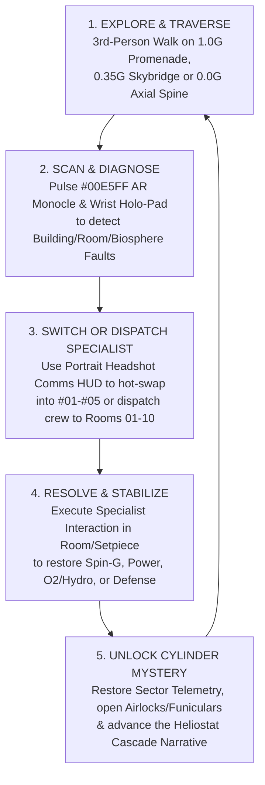
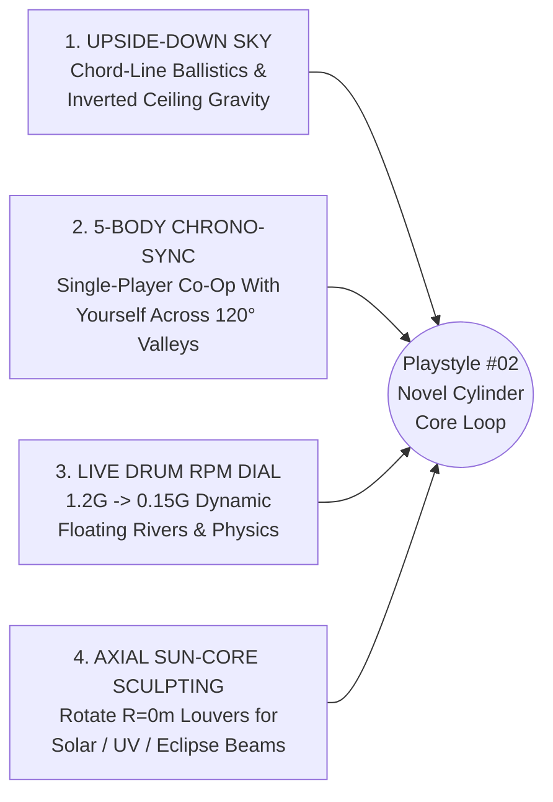
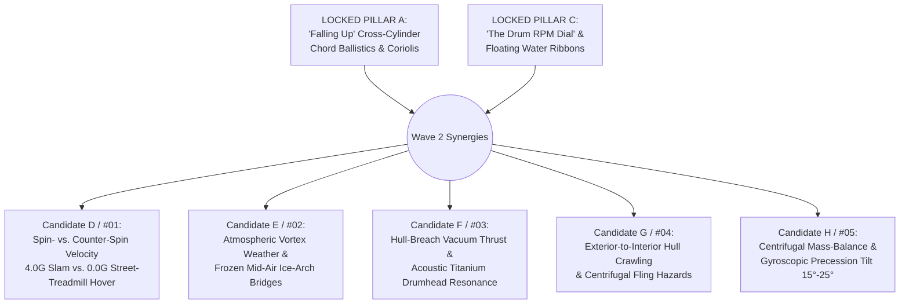

# Cylinder Hab-7 — Market Research, Playstyle Matrix & Core Gameplay Mechanics Specification
**Author:** Quinn (`65d82323-1864-40e3-b8eb-90acde92ed1d`) — Market Research & Gameplay Mechanics Strategist  
**Canonical Path:** `/workspace/game-project/design/market_research_and_core_mechanics_spec.md`  
**Mirror Path:** `/workspace/game-project/design/quinn_market_research_and_gameplay_mechanics_spec.md`  
**Target Engine & Scene Pipeline:** Godot 4.3 (`cylinder_interior_showcase.tscn`, `cylinder_hab7_metropolis.tscn`, `room_01`..`room_10`, and `char_crew_winner_01_aegis7_commander.glb` + 5-Specialist Crew Lineup)  
**Visual Benchmark Verified Against Renders:**
- `/workspace/game-project/godot/renders/cylinder_interior/cylinder_interior_showcase_sheet.png` (`CAM 01`–`CAM 04`: 800m × 400m `R = 200m` rotating O'Neill Cylinder with 3 asymmetric biomes, Golden-Hour Axial Sun `#FFE3B3`, Valley A Civic Acropolis, Valley B Waterfall Biosphere, Valley C Industrial Port, and 5 Hero Macro-Setpieces)
- `/workspace/game-project/godot/renders/character/character_crew_headshots_sheet.png` & `/workspace/game-project/godot/renders/character/character_walk_cycle_showcase_sheet.png` (5 distinct 7,100–8,400 tri sculpted crew specialists `#01`–`#05` with open/retracted headgear, 3-point Rembrandt studio portrait lighting, and `1.20s` biomechanical `WalkCycle` on the Civic Promenade)
- `/workspace/game-project/godot/renders/buildings/metropolis/cylinder_hab7_metropolis_sheet.png` (20 Locked `#02` Aegis-7 buildings + 5 exterior set props + 10 interior rooms)

---

## Section 1 — PC/Steam & Console Market Research & Visual Benchmark Analysis

### 1.1 Visual & Structural Audit of Our Built Assets
Inspecting our completed Godot 4.3 renders reveals four defining commercial strengths of the **Aegis-7 Standard** asset library:
1. **Unmistakable Silhouette & Color Readability at Every Scale:** Crisp 45°-chamfered low/mid-poly geometry (`3,000–6,000` tris per building/setpiece, `7,112–8,396` tris per character) with `<1.2%` micro-noise PBR surfaces, high-contrast Matte Aerospace White (`#D8DEE6`) vs. Anodized Gunmetal (`#1A1E24`), Signal-Orange (`#D95B26`) interactive affordances, and emissive telemetry (`#00E5FF` Cyan, `#FF9500` Amber, `#00E676` Emerald, `#7B5CFF` UV-Violet) reads clearly both from a 400m cross-cylinder vista (`cylinder_interior_showcase_sheet.png`) and at 0.6m portrait range (`character_crew_headshots_sheet.png`).
2. **Expressive Character Identity Without AAA Photorealism Overhead:** Because `#01` Lt. Marcus Vance-Lin, `#02` Cmdr. Kaelen Rostov, `#03` Chief Eng. Tarek Mensah, `#04` Dr. Soren Sato, and `#05` Spec-Ops Vesper Kade have sculpted 3D faces, distinct skin tones, hair/beards, and open/retracted headgear (`character_crew_headshots_sheet.png`), they anchor character-driven RPG/comms HUD drama (`Citizen Sleeper` / `XCOM` / `The Alters` style) while also functioning as full-body 3rd-person traversal avatars (`character_walk_cycle_showcase_sheet.png`).
3. **True 360° Concave World Horizon Hook:** In `CAM 01`–`CAM 04` of `cylinder_interior_showcase_sheet.png`, looking up from the Valley A Civic Promenade (`180°`) directly at the inverted Emerald Waterfall Biosphere (`60°`) and Industrial Shipyard (`300°`) 400m overhead—spanned by the 120° Suspension Skybridge Viaduct and Radial Tether-Elevator Spokes—creates an instant viral screenshot/trailer hook that no flat-terrain sci-fi game on Steam offers.
4. **Complete Indoor-to-Outdoor Systemic Loop Coverage:** Having all **10 Interior Rooms** (Sleeping Quarters, Transit Corridor, Galley, Medbay, EVA Chamber, Hydroponics, Bridge, Observation Lounge, Reactor Core, Cargo/Drone Bay) paired 1:1 with **20 Exterior District Buildings** and **5 Macro-Setpieces** allows seamless transitions between macro-habitat crisis triage and intimate room-scale diagnostics.

### 1.2 Steam/PC & Console Market Benchmark Matrix (14 Comparable Titles)

| Comparable Title | Core Subgenre & Camera | Visual Fidelity Tier | Steam Reception & Commercial Performance | Key Market Lesson for *Cylinder Hab-7* |
| :--- | :--- | :--- | :--- | :--- |
| ***Outer Wilds*** (Mobius / Annapurna) | 1st/3rd-Person Systemic Space Mystery & Physics Traversal | Stylized low/mid-poly geometric sci-fi | **95% Overwhelmingly Positive** (~58,000+ reviews; >4M copies) | Players love real orbital/rotational physics (Centrifugal/Coriolis forces) and clockwork systemic mysteries where knowledge + spatial traversal unlock the habitat. |
| ***Citizen Sleeper*** (Jump Over The Age) | Rotating O'Neill Station Narrative RPG & Systems Survival | Clean geometric low-poly station + expressive character portraits | **94% Very Positive** (~5,500+ reviews; >1M players incl. Game Pass) | Proves there is massive appetite for life inside a decaying rotating O'Neill cylinder ("The Eye") driven by daily cycle clocks, sector triage, and strong portrait dialogue. |
| ***Deliver Us The Moon* & *Deliver Us Mars*** (KeokeN) | 3rd-Person Over-the-Shoulder Hard-Sci-Fi Astronaut Adventure | Clean mid-poly hard-sci-fi modules, holographic scanning & 0G EVA | **88% Very Positive** (~7,500+ reviews) | Over-the-shoulder 3rd-person traversal showing the astronaut's backpack telemetry, wrist holo-projector, and transition from 1G walks to 0G EVA thrusters is the gold standard for solo/small-team sci-fi adventure. |
| ***Subnautica*** (Unknown Worlds) | Systemic Biome Exploration, Scanner Diagnostics & Habitat Repair | Stylized clean hard-sci-fi (`Alterra` white/orange/cyan aesthetic) | **96% Overwhelmingly Positive** (~260,000+ reviews; >6M copies) | Our Aegis-7 `#D8DEE6` white + `#D95B26` orange + `#00E5FF` cyan palette is a dead-ringer for *Subnautica*'s beloved Alterra aesthetic; a **Holo-Scanner tool** that diagnoses every prop/building/anomaly is an addictive core verb. |
| ***The Alters*** (11 bit studios) | Multi-Specialist Crew Management + 3rd-Person Base/Station Crisis | Stylized hard-sci-fi modular rooms + distinct specialist crew roles | **Top Steam Wishlist / Breakout Hit** (90%+ positive sentiment) | Switching between/dispatching distinct named specialists (Engineer, Scientist/Botanist, Technician, Guard, Commander) to maintain interlocking life-support rooms creates high emotional & strategic stakes. |
| ***IXION*** (Bulwark Studios) | Rotating Torus/Cylinder Station Sector Survival & Crisis Sim | Clean geometric hard-sci-fi station divided into 6 hull sectors | **79% Mostly Positive** (~12,500+ reviews; >500k copies) | Managing Hull Integrity, Power, Cryo/Seed Vaults, and Crew Trust across distinct sectors of a rotating cylinder is commercially proven—but players wished they could walk the promenade at human scale! |
| ***Hardspace: Shipbreaker*** (Blackbird Interactive) | Zero-G Industrial EVA Physics, Grapple-Tether & Reactor Salvage | High-visibility industrial sci-fi (caterpillar-amber, gunmetal, cyan) | **90% Very Positive** (~17,000+ reviews) | Validates Valley C's industrial shipyard/reactor gameplay and Chief Eng. Tarek Mensah's (`#03`) magnetic grapple-tether and zero-G EVA hazard disarming loop. |
| ***Signalis*** (rose-engine) | Stylized Low-Poly Survival-Mystery & Diegetic Diagnostic Puzzles | Deliberate low-poly faceted characters + crisp portrait UI & CRT/OLED HUD | **96% Overwhelmingly Positive** (~22,000+ reviews) | Proves that faceted low-poly characters (`7k–8k` tris) paired with razor-sharp lighting and diegetic diagnostic interfaces are celebrated as a deliberate prestige art style, not a budget compromise. |
| ***Observation*** (No Code) | Orbital Station Telemetry, Camera/Gimbal Switching & Mystery | Hard-sci-fi modular space station corridors, airlocks & reactor bays | **84% Very Positive** (~3,800+ reviews) | Using diegetic station telemetry, shoulder camera gimbals (`#02` Rostov's right shoulder), and schematic overlays to diagnose habitat faults creates gripping hard-sci-fi immersion. |
| ***Tacoma*** (Fullbright) | Rotating Orbital Station AR Holo-Replay & Crew Investigation | Clean color-coded station districts (Botany, Medical, Engineering, Hub) | **87% Very Positive** (~3,200+ reviews) | Color-coded biomes + AR holographic telemetry reconstructions inside a rotating station make narrative investigation effortless to read and navigate. |
| ***Astroneer*** (System Era) | Stylized Low-Poly Sci-Fi Backpack Telemetry & Tether Networks | Ultra-clean low-noise geometric sci-fi with 100% diegetic backpack UI | **92% Very Positive** (~115,000+ reviews) | Putting O2, Power, and Cryo-Coolant bars directly on the character's dorsal backpack (`char_walk_cycle_showcase_sheet.png` Panel 05) eliminates UI clutter and delights players. |
| ***Lethal Company*** (Zeekerss) | Low-Poly Sci-Fi Facility Quota/Anomaly Recovery & Hazard Comms | Low-poly faceted suits, high-contrast lighting & terminal monitors | **97% Overwhelmingly Positive** (~350,000+ reviews) | High-contrast low-poly sci-fi suits entering hazardous industrial/facility rooms under time/oxygen pressure with terminal telemetry support have massive streamer appeal. |
| ***FTL: Faster Than Light* / *Into the Breach*** (Subset Games) | Room-by-Room Crew Specialist Triage & Power Routing | Clean readable room/grid telemetry & specialist abilities | **95% Overwhelmingly Positive** (~90,000+ reviews) | Routing power between Reactor (`Room 09`), Medbay (`Room 04`), O2/Hydro (`Room 06`), Bridge (`Room 07`), and Defense (`bldg_20`) while assigning crew to repair breaches is timelessly replayable. |
| ***Prey* (2017)** (Arkane) | Art-Deco/Hard-Sci-Fi Orbital Station Immersive Sim & Zero-G Spine | Interconnected orbital station districts + zero-G central utility spine | **90% Very Positive** (~35,000+ reviews) | Using the zero-G central axial spine (`interior_setpiece_03`) as a fast, hazardous 3D shortcut linking all 3 valleys and the Aft Starport Throat turns the cylinder geometry into a giant systemic puzzle box. |

---

## Section 2 — 5 Playstyle / Genre Candidates (`Playstyle #01` – `Playstyle #05`) & Scoring Matrix

Following our studio's 5-Candidate Tournament convention (`#01`–`#05`), we evaluated **5 distinct playstyle architectures** against our built Godot 4.3 assets:

### Candidate `#01` — Pure Walking Simulator & Environmental Audio-Log Mystery (*Tacoma* / *Everybody's Gone to the Rapture* Style)
- **Concept:** Solo 3rd-person walk through an evacuated Cylinder Hab-7, triggering holographic audio logs at Wayfinding Kiosks (`prop_02`) and cabin desks (`walldesk_winner_01`) to piece together why the colony went into lockdown.
- **Pros:** Fastest to script; showcases our 3 valleys and 10 rooms as a virtual museum.
- **Cons:** Underutilizes our 5 distinct crew specialists (`#01`–`#05`), leaves the 20 functional buildings passive, and has the lowest Steam replayability/retention ceiling (`3–4 hour` one-and-done playtimes suffer from high Steam refund rates unless priced very low).

### Candidate `#02` (RECOMMENDED FLAGSHIP WINNER) — 3rd-Person Systemic Habitat Mystery, 5-Specialist Crew Switching & Crisis Triage Adventure (*Deliver Us The Moon* × *Subnautica* × *The Alters* / *Citizen Sleeper*)
- **Concept:** A **65/35 Hybrid Systemic Sci-Fi Adventure**:
  - **Primary 65% Pillar (Human-Scale 3rd-Person Exploration, Spin-G Traversal & AR Diagnostics):** You directly control **Commander Kaelen Rostov (`#02`)**—and can hot-swap at any Wayfinding Kiosk (`prop_02`) or Comms Terminal into any of the **5 Aegis-7 Crew Specialists (`#01`–`#05`)**—walking the `1.0G` Civic Promenade, ascending the `0.35G` Ring-Spanning Skybridge (`interior_setpiece_01`) and Cliffside Funicular (`interior_setpiece_04`), and flying `0.0G` EVA along the Axial Sun-Core (`interior_setpiece_03`). You use Rostov's **Left-Eye Cyan AR Monocle (`#00E5FF`)** and **Left-Forearm Wrist Holo-Projector** to scan anomalies, diagnose failing habitat infrastructure, and uncover the mystery of the "Heliostat Cascade."
  - **Secondary 35% Pillar (Tri-Biome Habitat Systems Triage & Specialist Dispatch):** Across a structured **Spin-Cycle Day/Night Loop**, the cylinder's 3 asymmetric valleys (Valley A Civic Metropolis, Valley B Emerald Biosphere, Valley C Industrial Shipyard/Reactor) experience cascading systemic faults. Using our **Portrait Headshot Comms HUD (`character_crew_headshots_sheet.png`)**, you assign non-active specialists to stabilize the 10 interior rooms and 20 exterior buildings or switch directly into their boots to execute specialist room/setpiece repairs yourself!
- **Why `#02` Wins:** It uses **100% of our built assets** (all 5 rigged characters + headshots + walk cycle, all 10 rooms, all 20 buildings, all 5 plaza props, and all 5 interior macro-setpieces), hits the highest-performing Steam indie-AA tags (`Sci-Fi + Exploration + Mystery + Base/Station Management + Character Action`), and delivers both breathtaking 3rd-person megastructure scale and deep replayable systems.

### Candidate `#03` — Top-Down / Axial Isometric Real-Time-with-Pause Colony & Disaster Management Sim (*IXION* / *Frostpunk* / *FTL* Style)
- **Concept:** Camera stays pulled back in the cylinder center (`Y = 200m` axial view); players manage resource bars, assign the 5 crew members as small icons between the 20 buildings, and construct/upgrade sectors.
- **Pros:** Strong strategic retention on Steam.
- **Cons:** Wastes our human-scale 18-node `WalkCycle` animation (`character_walk_cycle_showcase_sheet.png`), close-up 3D interior room fixtures (bunks, sonic vanity, drop-leaf desk, autodoc), and the awe of looking *up* at the 360° curved overhead valleys from street level (`CAM 02`).

### Candidate `#04` — Co-Op / Squad-Extraction Industrial Hazard & Quota Salvage (*Lethal Company* / *Hardspace: Shipbreaker* Style)
- **Concept:** Up to 4–5 crew specialists deploy from the EVA Chamber (`Room 05`) into decompressed/hazardous sectors of Valley C and the Aft Starport Throat to salvage reactor cores and cryo-seeds before Spin-Gravity shear or radiation storms hit.
- **Pros:** High streamer/viral potential and intense moment-to-moment physics loops.
- **Cons:** Requires multiplayer netcode or complex AI squad pathfinding in dynamic gravity, and treats our lush Valley A Civic Metropolis and Valley B Botanical Conservatory as hazardous ruin arenas rather than a living hard-sci-fi habitat.

### Candidate `#05` — Turn-Based Tactical Squad Recon & Point-Defense Strategy (*XCOM* / *Alien: Dark Descent* / *Syndicate* Style)
- **Concept:** Grid/cover-based tactical squad combat across the stepped terraces of Valley A (`interior_setpiece_05`), Hydro-Dam (`interior_setpiece_02`), and Industrial Switchyards (`Valley C`) led by Spec-Ops Vesper Kade (`#05`) and Cmdr. Rostov (`#02`).
- **Pros:** Uses our stepped 3-tier acropolis podiums and 45°-chamfered cover geometry well.
- **Cons:** Requires enemy AI factions, weapon ballistics, and combat animation sets (aim, crouch, hit-react, death) that diverge from our hard-sci-fi *2001* / *Interstellar* / *Rama* cinema pedigree.

### 2.1 Quantitative Playstyle Scoring Matrix (Out of 40 Points)

| Playstyle Candidate | Steam Market Viability (0–10) | Visual Style Fit (Aegis-7 Low-Poly & Headshots) (0–10) | Asset Reuse & Scope Efficiency (10 Rooms, 20 Bldgs, 5 Crew) (0–10) | Hook, Streamability & Retention (0–10) | **Total Score (/40)** | Verdict |
| :--- | :---: | :---: | :---: | :---: | :---: | :--- |
| **`#01` — Pure Narrative Walking Sim** | 6.5 | 8.0 | 6.5 | 6.0 | **27.0 / 40** | Too passive; wastes 5-specialist kit & 20 buildings |
| **`#02` — 3rd-Person Systemic Habitat Mystery, Crew Switching & Crisis Triage (65/35 Hybrid)** | **9.5** | **9.8** | **10.0** | **9.5** | **38.8 / 40** | **LOCKED FLAGSHIP RECOMMENDATION (`#02`)** |
| **`#03` — Axial Top-Down Colony Management Sim** | 8.5 | 7.5 | 7.0 | 8.0 | **31.0 / 40** | Loses street-level 360° horizon awe & walk cycle |
| **`#04` — EVA Salvage & Quota Extraction Loop** | 8.5 | 8.2 | 7.5 | 9.0 | **33.2 / 40** | Great secondary mode for Valley C, too narrow alone |
| **`#05` — Turn-Based Tactical Squad Strategy** | 8.0 | 8.0 | 6.5 | 7.8 | **30.3 / 40** | Requires heavy combat/enemy animation pipeline |

---

## Section 3 — Core Gameplay Loop (Minute-to-Minute, Hour-to-Hour & Day-to-Day Spin Cycle)

Under **Playstyle `#02`**, gameplay flows across three tightly nested rhythms:

1. **Minute-to-Minute Loop (Explore -> Scan -> Switch/Interact -> Stabilize):**
   - **Traverse:** Walk the curved Valley A promenade (`1.0G`), ride a Wayfinding Kiosk Mag-Lev shuttle (`prop_01` / `prop_02`), climb the Stepped Cliffside Funicular (`interior_setpiece_04`, `0.35G`), or launch into the `0.0G` Axial Sun-Core (`interior_setpiece_03`).
   - **Scan:** Trigger Cmdr. Rostov's **Left-Eye Cyan AR Monocle (`#00E5FF`)** to see subsurface power conduits, O2 airflow vectors, and structural stress fractures connecting exterior buildings (`bldg_01`–`bldg_20`) to their interior rooms (`room_01`–`room_10`).
   - **Switch or Dispatch:** Open the **Left-Forearm Wrist Holo-Projector** (`Tab` / `R1`) to bring up the **5-Specialist Portrait Comms HUD** (`character_crew_headshots_sheet.png`). Either remotely order Chief Eng. Mensah (`#03`) to stabilize `Room 09` (Reactor Core) while you investigate `bldg_08` (Astrometry Observatory), or **instant-swap control** directly into Mensah's boots on-site!
2. **Hour-to-Hour Loop (Tri-Biome Crisis Triage & Cross-Valley Chain Reactions):**
   - Because Cylinder Hab-7 is a closed-loop 800m × 400m ecosystem, every valley depends on the other two:
     - **Valley C (`300°` Industrial/Power)** generates D-He3 Fusion Power (`bldg_12` / `Room 09`) and Spin-Drive angular velocity (`ω`) for the whole drum, but requires cooling water from **Valley B (`60°`)**.
     - **Valley B (`60°` Emerald Agri-Biosphere)** pumps reclaimed water over the Stepped Waterfall Hydro-Dam (`interior_setpiece_02` / `bldg_09`) and scrubs CO2 into O2 (`bldg_06` / `bldg_07` / `Room 06`), feeding **Valley A (`180°`)**.
     - **Valley A (`180°` Civic Metropolis & Citadel)** houses the Command Bridge (`bldg_11` / `Room 07`), Trauma Medbay (`bldg_04` / `Room 04`), Crew Quarters (`bldg_01` / `Room 01`), and Coriolis Conditioning Arena (`bldg_17`), keeping the 5 specialists healthy, rested, and coordinated.
3. **Day-to-Day Circadian Spin Cycle (Golden-Hour -> Solar Zenith -> Violet-UV Night Cycle):**
   - Controlled by the **Axial Sun-Core Heliostat Louvers (`interior_setpiece_03`)**, each 24-minute real-time cycle transitions the cylinder lighting from **Golden-Hour Dawn (`#FFE3B3`, seen in `cylinder_interior_showcase_sheet.png`)** to **Solar Zenith (`#FFF4E0`)** to **Bioluminescent UV-Night (`#7B5CFF` / `#00E5FF`)**, triggering scheduled meteor swarms (`bldg_20`), cryo-seed thermal checks (`bldg_10`), and crew rest/comms briefings in `Room 01` (Sleeping Quarters) and `Room 03` (Mess Hall Galley).

---

## Section 4 — 5 Concrete Lock-In Mechanics (Buildable Godot 4.3 Specifications for Gage)

These 5 modular mechanics are engineered to drop directly into Gage's existing Godot 4.3 scenes (`cylinder_interior_showcase.tscn`, `cylinder_hab7_metropolis.tscn`, and `room_01`..`room_10.tscn`) using our existing `.glb` assets and textures:

---

### Lock-In Mechanic #1: 3rd-Person Over-the-Shoulder Promenade Traversal & Radial Spin-G Gravity Zones (`1.0G` / `0.35G` / `0.0G`)
- **Visual & Physics Grounding:** Inside our rotating O'Neill Cylinder (`R_DRUM = 200.0m`, axis along `X` at `Y = 200.0m, Z = 0.0m`), artificial gravity is centrifugal (`g(r) = ω² · r`), pointing **radially outward** toward the hull floor (`R_HULL_FLOOR = 185.5m`), while "Up" points **radially inward** toward the central Sun-Core (`Y = 200.0m, Z = 0.0m`).
- **Exact Godot 4.3 `CharacterBody3D` Math:**
  - At any world position `pos = global_position`, radial vector from the central spin axis is:
    $$\vec{r}_{radial} = \text{Vector3}(0.0,\; pos.y - 200.0,\; pos.z), \quad r = |\vec{r}_{radial}|$$
  - Character `up_direction` dynamically aligns to the local cylinder normal:
    $$\text{up\_direction} = -\frac{\vec{r}_{radial}}{r} = \text{Vector3}(0.0,\; 200.0 - pos.y,\; -pos.z).\text{normalized}()$$
  - Effective Spin-Gravity magnitude scales linearly with radius $r$, plus tangential **Coriolis deflection** ($\vec{a}_{coriolis} = -2\vec{\omega} \times \vec{v}$) during airborne jumps or high-altitude viaduct traversal:
    $$g_{eff}(r) = 9.81 \cdot \text{clamp}\left(\frac{r}{185.5},\; 0.0,\; 1.0\right)\text{ m/s}^2$$
- **The 3 Distinct Playable Gravity Zones:**
  1. **`1.0G` Valley Floor & Civic Promenade (`r = 185.5m .. 168.0m`):** Full grounded biomechanical `WalkCycle` (`1.20s` loop at `walk_speed = 3.8 m/s`, `run_speed = 6.8 m/s`), crisp footstep audio with `#FF9500` amber heel-strike LED pulses on magnetic boots.
  2. **`0.35G – 0.65G` Mid-Ring Viaduct, Hydro-Dam & Cliffside Terraces (`r = 168.0m .. 75.0m` on `interior_setpiece_01` Skybridge & `interior_setpiece_04` Endcap Citadel):** Low-gravity moon-stride with `2.4×` jump height, noticeable Coriolis spinward/antispinward curve on jumps, and toggleable **Mag-Boot Clamp (`M` key)** for high-wind solar baffle catwalks.
  3. **`0.0G` Axial Sun-Core Hub & Aft Starport Throat (`r < 45.0m` on `interior_setpiece_03`, `bldg_14` EVA Pinnacle, and `Room 04 / 05 / 08`):** Automatic switch to **6-DOF Dorsal Micro-Thruster EVA Flight** + **Right-Forearm Magnetic Grapple-Tether** (`E` / `RMB`) to zip between axial heliostat baffles and zero-G docking rings!
- **Over-the-Shoulder Camera Rig (`SpringArm3D` + `Camera3D`):**
  - Default offset `Vector3(0.42, 1.62, -2.35)` (`FOV = 68°`), framing the active character's 65/35 dorsal cryo-coolant backpack (`character_walk_cycle_showcase_sheet.png` Panel 05) on the left third while keeping the **360° curving overhead valleys (`60°` and `300°`)** visible in the upper half of the frame.

---

### Lock-In Mechanic #2: 5-Specialist Crew Switching & Portrait Headshot Comms HUD
- **Direct Use of `character_crew_headshots_sheet.png` & `char_crew_r1_01..05.glb`:**
  - All 5 crew models are persistently instantiated in Cylinder Hab-7 at their active duty stations (or walking between their assigned building and interior room).
  - Pressing `Tab` (or `1`–`5` hotkeys) raises theactive character's **Left-Forearm Wrist Holo-Projector** and displays the **Aegis-7 5-Specialist Portrait Comms Strip** across the upper-left/bottom-left HUD using our rendered close-up headshots (`char_crew_headshot_01.png` .. `05.png`), complete with live ECG/O2/Spin-G telemetry bars.
  - Players can **Instant Hot-Swap (`Switch Control`)** to any of the 5 specialists (with a 0.8s *GTA V* / *Driver: San Francisco*-style axial camera zoom across the cylinder interior to the target specialist's location!) OR **Issue Remote Triage Orders (`Dispatch to Room/Building`)** while staying in Commander Rostov's boots.

| Crew ID & Model | Specialist Name & Title | Signature Visual Gear (`headshots_sheet.png`) | Unique Active Gameplay Ability | Home Exterior Buildings | Home Interior Rooms |
| :--- | :--- | :--- | :--- | :--- | :--- |
| **`#02` (HERO LEAD)** `char_crew_r1_02.glb` | **Cmdr. Kaelen Rostov** (*Habitat Commander*) | Left-eye Cyan (`#00E5FF`) AR Monocle, 65/35 open half-cowl, `#D95B26` EVA strap, shoulder camera gimbal, wrist holo-pad | **AR Monocle X-Ray Scan & Command Override:** Sees hidden power/O2/structural fault lines through walls; unlocks Bridge/Citadel master overrides; grapple-tether. | `bldg_11` Citadel HQ, `bldg_18` Holo-Museum, `bldg_05` Promenade Dome | `Room 07` Bridge, `Room 01` Quarters, `Room 08` Lounge |
| **`#01`** `char_crew_r1_01.glb` | **Lt. Marcus Vance-Lin** (*Flight & Logistics Officer*) | Flip-up aerospace-white/cobalt flight visor crown, dual-ear comms pods, cyan collar pips | **Mag-Lev & Drone Fleet Pilot:**pilots VTOL Med-Evac/Cargo shuttles (`prop_05`), overrides Mag-Lev Skybridge trains (`interior_setpiece_01`), deploys cargo drones. | `bldg_02` Transit Rotunda, `bldg_13` Cargo Port, `bldg_14` EVA Pinnacle | `Room 02` Transit Corridor, `Room 10` Cargo & Drone Bay |
| **`#03`** `char_crew_r1_03.glb` | **Chief Eng. Tarek Mensah** (*Heavy EVA & Reactor Eng.*) | Open Caterpillar-Amber (`#FFB703`) exo-roll-cage, forehead LED floodlamp, braided hair, heavy MMU pack | **Exo-Servo Lift & Plasma Pinch Stabilization:** Repairs D-He3 fusion coils, clears jammed shipyard drydock clamps, immune to arc-weld/radiation hazards. | `bldg_12` Fusion Reactor, `bldg_16` Shipyard Drydock, `bldg_09` Aquifer Pump | `Room 09` Reactor Core, `Room 05` EVA Prep Chamber |
| **`#04`** `char_crew_r1_04.glb` | **Dr. Soren Sato** (*Bio-Med & Hydro Specialist*) | Visorless Emerald (`#00E676`) & UV-Violet (`#7B5CFF`) neural headband, frameless holo-glasses, silver/emerald bob | **Bio-Pathogen & Hydro-Cascade Triage:** Heals crew trauma in Autodoc, balances O2/CO2 algae scrubbers, unlocks Cryo-Seed genetic vaults & botanical overdrive. | `bldg_04` Medical Center, `bldg_06` Biodome, `bldg_07` Atmo Plant, `bldg_10` Seed Vault | `Room 04` Medbay, `Room 06` Hydroponics, `Room 03` Galley |
| **`#05`** `char_crew_r1_05.glb` | **Spec-Ops Vesper Kade** (*Tactical & Sensor Recon*) | Faceted carbon-slate jaw rebreather, amber/cyan optic strip, cybernetic temple implant, undercut mohawk | **High-G Sprint, Zero-O2 Stealth & Point-Defense:** Operates in vacuum/toxic sectors without O2 drain, calibrates Meteor Defense lasers & Astrometry arrays. | `bldg_20` Defense Bastion, `bldg_08` Observatory, `bldg_15` Solar-Mirror Pylon, `bldg_17` Coriolis Arena | `Room 05` EVA Airlock, `Room 07` Tactical Overwatch |

---

### Lock-In Mechanic #3: AR Monocle Scanner & Holo-Telemetry Diagnostic Pulse (`#00E5FF` / `#FF9500` / `#00E676`)
- **Grounded in Rostov's Left-Eye Cyan AR Monocle & Sato's Holo-Glasses:**
  - Holding `RMB` / `L2` activates the **Aegis-7 AR Diagnostic Overlay**:
    - Sends an expanding spherical `#00E5FF` cyan wireframe shader pulse (`radius = 0m -> 45m`) across the surrounding room or promenade.
    - Highlights every interactive fixture (`locker_winner_01`, `vanity_winner_01`, `walldesk_winner_01`, `climate_winner_01`, `bridge_console_winner_01`, `reactor_core_winner_01`), exterior prop (`prop_01`–`prop_05`), and building (`bldg_01`–`bldg_20`) with a color-coded status bracket:
      - **Cyan (`#00E5FF`):** Nominal / Scannable Lore & Telemetry Entry
      - **Emerald (`#00E676`):** Optimal Biosphere / Overclocked Output
      - **Amber (`#FF9500`):** Warning / Degrading Efficiency (Requires preventative specialist tune-up)
      - **Signal-Orange / Red (`#D95B26`):** Critical Fault / Active Breach (Requires immediate specialist repair)
  - Completing scans populates the **Cylinder Hab-7 Architectural & Systems Codex**, rewarding players who inspect Vance, Sloane, and Rook's intricate 65/35 prop details!

---

### Lock-In Mechanic #4: Tri-Biome Habitat Crisis & Systems Triage Loop (4 Interlocking Habitat Bars)
- **Turning Our 20 Buildings & 10 Rooms into a Living Machine:**
  - The cylinder's health is tracked via **4 Diegetic Habitat Telemetry Pillars** displayed on the Command Citadel Holo-Table (`Room 07`), Wrist Holo-Projector, and Wayfinding Kiosks (`prop_02`):
    1. **Spin-G & Hull Integrity (`1.00G` / `1.98 RPM` — Amber `#FF9500`):** Driven by `bldg_11` Citadel, `bldg_16` Shipyard, `bldg_20` Meteor Bastion, and `prop_03` Harmonic Bollards. If Spin-G drifts (`0.65G` or `1.35G`), character walk/jump physics dynamically change across the entire cylinder!
    2. **D-He3 Fusion & Solar-Core Output (`100% MW` — Cyan `#00E5FF`):** Driven by `bldg_12` Fusion Reactor (`Room 09`), `bldg_15` Solar-Mirror Pylon, and `interior_setpiece_03` Axial Sun-Core. Power brownouts dim sector lighting from Golden-Hour `#FFE3B3` to emergency `#D95B26` backup strobes.
    3. **Biosphere O2 & Hydro-Cascade Equilibrium (`98% O2 / H2O` — Emerald `#00E676`):** Driven by `interior_setpiece_02` Waterfall Hydro-Dam, `bldg_06` Biodome (`Room 06`), `bldg_07` Atmo Processor, `bldg_09` Aquifer Pump, and `bldg_10` Cryo-Seed Vault.
    4. **Crew Stamina, Circadian Sync & Medical Readiness (`5/5 Crew Ready` — Violet `#7B5CFF`):** Driven by `Room 01` Sleeping Quarters (4 locked bunk winners), `Room 03` Galley, `Room 04` Medbay (`bldg_04`), and `Room 08` Observation Lounge (`bldg_05`).

---

### Lock-In Mechanic #5: Wayfinding Kiosk Fast-Transit, Skybridge Mag-Lev & Radial Funicular Network
- **Solving 800m × 400m Megastructure Traversal Without Tedium:**
  - Walking 800m on foot takes ~3.5 minutes, which is awesome for soaking in views (`CAM 06` in `character_walk_cycle_showcase_sheet.png`) but needs high-speed diegetic transit for crisis response.
  - Interacting (`E` key) with any **Octagonal Holo-Wayfinding Kiosk (`prop_02_winner_01_holo_wayfinding_kiosk.glb`)** opens a 3D rotating holographic map of Cylinder Hab-7 linking three real-time transit tiers:
    1. **Circumferential Ring Transit (`interior_setpiece_01` 120° Suspension Skybridge Viaduct & `bldg_02` / `prop_01` Mag-Lev Pods):** Fast-rides around the `R = 185.5m..152m` hull curve between **Valley A (`180°` Civic)**, **Valley B (`60°` Biosphere)**, and **Valley C (`300°` Industrial)** in 8 seconds with a live panoramic window camera!
    2. **Radial Zero-G Elevator Spokes & Cliffside Funicular (`interior_setpiece_03` & `interior_setpiece_04`):** Lifts the player vertically from the `1.0G` valley floor (`R = 185.5m`) up to the `0.0G` Axial Sun-Core Sphere (`R = 0m, Y = 200m`), watching gravity count down (`1.0G -> 0.5G -> 0.0G`) on the suit's chest OLED console.
    3. **Building Exterior <-> Interior Room Airlock Portals (`Room 02` Dual-Zone Airlock Door):** Walking up to the glowing `#D95B26` signal-orange / `#00E5FF` cyan entrance portal of key buildings (`CAM 04` of `cylinder_hab7_metropolis_sheet.png`) seamlessly transitions into the corresponding high-detail interior room (`room_01`..`room_10`)!

---

## Section 5 — Buildable GDScript Architecture for Gage (Phase 5 Prototype Implementation Blueprint)

To lock these mechanics into Godot 4.3 with minimal friction and low token overhead, Gage can implement three modular scripts under `/workspace/game-project/godot/scripts/gameplay/`:

1. **`cylinder_character_controller.gd` (attaches to `CharacterBody3D` wrapping `char_crew_winner_01_aegis7_commander.glb` & `char_crew_r1_01..05.glb`):**
   - Computes dynamic radial `up_direction = Vector3(0.0, 200.0 - global_position.y, -global_position.z).normalized()` and `spin_g = clamp(radial_dist / 185.5, 0.0, 1.0)`.
   - Blends the embedded `1.20s` `WalkCycle` `AnimationPlayer` speed scale proportional to ground velocity in `1.0G–0.25G`, and switches to 6-DOF thruster impulse + grapple raycast when `spin_g < 0.20`.
   - Includes a third-person `SpringArm3D` camera rig with smooth `FOV` zoom (`68°` Explore <-> `42°` AR Scan/Comms).
2. **`crew_specialist_hud_and_switcher.gd` (attaches to `CanvasLayer` UI + Crew Manager Node):**
   - Loads `/workspace/game-project/godot/renders/character/char_crew_headshot_01.png` .. `05.png` into a sleek Aegis-7 diegetic corner/comms bar (`#1A1E24` gunmetal frame, `#00E5FF` cyan active border, `#D95B26` alert badge).
   - Pressing `1`–`5` smoothly interpolates the active camera between crew specialists positioned in Valley A (`#02` Rostov at Citadel Acropolis, `#01` Vance-Lin at Skybridge Rotunda), Valley B (`#04` Dr. Sato at Waterfall Hydro-Dam), Valley C (`#03` Eng. Mensah at Fusion Reactor/Shipyard), and Forward Endcap/Bastion (`#05` Kade), or dispatches them to resolve active room faults.
3. **`ar_scanner_and_habitat_triage.gd` (attaches to Root Gameplay Node):**
   - Manages the 4 Habitat Telemetry Bars (`Spin-G`, `Fusion MW`, `Biosphere O2/H2O`, `Crew Readiness`), triggers the `#00E5FF` AR Monocle scan pulse (`RMB`), and links `prop_02` Wayfinding Kiosks to fast-transit spline cameras along `interior_setpiece_01` (Ring Skybridge) and `interior_setpiece_03` (Radial Elevator Spokes).

---

## Section 6 — Novel O'Neill-Cylinder-Exclusive Mechanics Suite for Playstyle #02 ("Only Possible in a Rotating Cylinder")

With **Playstyle `#02` (3rd-Person Systemic Habitat Mystery, 5-Specialist Crew Switching & Crisis Triage)** locked in by Jared (`[t34u]`), we elevate the design beyond conventional flat-planet sci-fi tropes (`press E to scan / repair`) by anchoring the core loop around **4 Novel Mechanics** that can *only* exist inside a rotating 800m × 400m (`R = 200m`) O'Neill Cylinder with 5 persistent crew bodies:

---

### Novel Mechanic #1: "Upside-Down Sky" Chord-Line Ballistics & Cross-Cylinder Tethering (`Coriolis + Inverted Ceiling Gravity`)
- **The High-Concept Hook:** In *Cylinder Hab-7*, the "sky" is not empty air—it is **two other cities (`Valley B` at `60°` and `Valley C` at `300°`) hanging upside-down `320m–370m` directly overhead** (`CAM 02` & `CAM 03` of `cylinder_interior_showcase_sheet.png`).
- **How the Physics Works (`Godot 4.3` Real-Time Rotating Frame Equation):**
  - Because centrifugal gravity points radially outward from the central axis ($\vec{g}(\vec{r}) = \omega^2 \vec{r}_{radial}$) and the Coriolis acceleration deflects moving objects tangentially ($\vec{a}_{coriolis} = -2\vec{\omega} \times \vec{v}$), any object, drone, or tether launched upward from `Valley A` (`180°`, bottom nadir) experiences **decreasing gravity** as it rises toward the `R = 0m` Sun-Core, and the moment it crosses the central axis or reaches the upper hemisphere, **gravity flips and pulls it "upward" so it falls into the city on the ceiling!**
  - Furthermore, firing a projectile straight "up" in the rotating frame causes a dramatic **S-curve Coriolis trajectory** across the cylinder interior, visible via an **`#00E5FF` AR Monocle Ballistic Ribbon Preview** before you fire.
- **Concrete Gameplay Applications:**
  1. **Ceiling-to-Floor Payload & Cryo-Canister Drops:** Standing in `Valley B` (`60°` Emerald Biosphere) on the "ceiling," Dr. Soren Sato (`#04`) can launch a volatile cryo-seed canister or hydro-coolant cell *upward* past the zero-G core so it arcs across the 400m drum and lands safely on the VTOL pad (`prop_05`) beside Commander Rostov (`#02`) in `Valley A` (`180°`)—bypassing blocked ring-corridor bulkheads (`Room 02`).
  2. **Cross-Chord Laser & Power-Relay Bouncing:** Align portable brushed-steel reflector tripods (`#88929E`) in `Valley A` to bounce high-energy plasma/communications beams straight through the open sky to a receiver perched upside-down on `bldg_12` (Fusion Reactor) in `Valley C` (`300°`).
  3. **Inverted Grapple-Drop & Freefall Sky-Diving:** Stepping off the cantilevered edge of the `R = 152m` Sky-Transfer Rotunda (`interior_setpiece_01`) or the `R = 0m` Axial Hub (`interior_setpiece_03`) lets you **sky-dive toward the wall of your choice**: fire a short dorsal thruster burst toward `60°`, and the cylinder's rotation catches you, smoothly rotating your camera 120° as the "wall" becomes the floor beneath your magnetic boots!

---

### Novel Mechanic #2: "Simultaneous 5-Body Chrono-Sync" (Single-Player Co-Op With Yourself Across the Drum)
- **The High-Concept Hook:** Why have 5 distinct crew models (`#01` Vance-Lin, `#02` Rostov, `#03` Mensah, `#04` Sato, `#05` Kade) if four of them sit idle when you aren't controlling them? With **5-Body Chrono-Sync**, you play **single-player co-op with yourself across the 360° cylinder**.
- **Seamless 120° Whip-Pan Camera Swap:**
  - All 5 crew specialists exist as live physical `CharacterBody3D` actors in the cylinder simultaneously.
  - When you select a crew member on the **Portrait Headshot Comms HUD (`character_crew_headshots_sheet.png`)**, the camera doesn't fade to black—it pulls back from `#02` Rostov's shoulder on the `Valley A` promenade, **whip-pans straight up across the 400m open sky while rolling `120°` around the X-axis**, and locks onto `#04` Dr. Sato's shoulder standing "upside-down" by the Waterfall Hydro-Dam in `Valley B` in `0.85 seconds`!
- **The 45-Second "Chrono-Sync Ghost Loop" (Multi-Specialist Synchronized Puzzles):**
  - Pressing `R` (`Record Sync Timeline`) starts a **45-second local hologram recording** for your current specialist:
    - **Step 1 (Act as Specialist A):** As `#03` Chief Eng. Tarek Mensah in `Valley C` (`300°`), pull a heavy spring-loaded plasma circuit breaker at `t = 08.0s`, hold open a magnetic crane gantry until `t = 25.0s`, and fire a signal flare across the sky at `t = 30.0s`.
    - **Step 2 (Rewind & Whip-Pan to Specialist B):** Hit `Tab + 2` to rewind the 45-second window and whip-pan down to `#02` Cmdr. Kaelen Rostov in `Valley A` (`180°`) or `#01` Lt. Vance-Lin on the Suspension Skybridge (`interior_setpiece_01`).
    - **Step 3 (Live Cross-Sky Co-Op Execution):** As you run along the Valley A promenade, **you can literally look up into the sky 350m overhead and watch Mensah executing your recorded actions in real time**, catching the power surge or cargo pod he just sent across the chord-line!
  - Up to **all 5 specialists** can be layered into a single 45-second Chrono-Sync window, turning complex habitat emergencies (which normally require a 5-person crew) into brain-bending, deeply satisfying spatial-temporal puzzles.

---

### Novel Mechanic #3: "Live Drum RPM Dial" (Centrifugal Gravity as an Interactive World-State Lever)
- **The High-Concept Hook:** In almost every sci-fi game, artificial gravity is either an invisible binary switch (`1G` on vs. `0G` off). In *Cylinder Hab-7*, gravity is generated physically by the rotation of the 800m × 400m hull ($\omega \approx 2.09\text{ RPM}$ for $1.0\text{G}$ at $R = 185.5\text{m}$). From the **Habitat Command Bridge (`Room 07` / `bldg_11`)** or **Spin-Drive Reactor Core (`Room 09` / `bldg_12`)**, you can **actively dial the cylinder's Spin RPM up or down**—physically transforming the geometry, water, and traversal rules of all 3 biomes at once!
- **Four Playable Spin-RPM World States:**

| Drum Spin Setting | Angular Velocity & Floor Gravity ($R = 185.5\text{m}$) | Visual Skybox & Coriolis Effect | Dynamic World-State Transformation Across Valleys A, B & C |
| :--- | :--- | :--- | :--- |
| **1. `0.08G` — "Spin-Brake / Micro-G Drift"** | `0.59 RPM` (`0.08G` floor) | External starfield slows to a crawl; ambient dust & droplets float | **Valley B's Meandering Ring-River & Hydro-Dam (`interior_setpiece_02`) detach from the ground**, rising into giant undulating **`alphaMode: "BLEND"` cyan/emerald water spheres and suspended aquatic tunnels** floating 40m in the air! Players can swim/jet through floating river globules to reach high cliff caves, and `#03` Mensah can push 20-ton shipyard hull plates (`bldg_16`) by hand. |
| **2. `0.38G` — "Lunar Low-G Stride"** | `1.29 RPM` (`0.38G` floor) | Gentle Coriolis curve on thrown/launched items | Any crew member can bound `18m` high onto building rooftops (`bldg_01`–`bldg_20`) without elevators; falling from the `R = 152m` Skybridge Viaduct (`interior_setpiece_01`) is survivable without thruster fuel. |
| **3. `1.00G` — "Aegis-7 Standard Nominal"** | `2.09 RPM` (`1.00G` floor) | Standard Golden-Hour rotation (`cylinder_interior_showcase_sheet.png`) | Normal biomechanical `1.20s` `WalkCycle`; waterfalls cascade cleanly down the 4-tier Hydro-Dam; medical surgeries (`Room 04`) and precision protein synthesis (`bldg_19`) operate at 100% efficiency. |
| **4. `1.45G` — "Over-Spin Centrifuge Surge"** | `2.52 RPM` (`1.45G` floor) | Fast external starfield spin; heavy radial downforce & severe Coriolis hook | Doubles output of the **Ring-Gravity Aquifer Cascade (`bldg_09`)** and purges dense toxic gas pockets down into the floor drains of `Valley C`, while pinning loose cargo/hazards firmly to the deck (at the cost of slower crew movement and disabling high jumps, except for `#03` Mensah's exo-suit and `#05` Kade's Coriolis conditioning). |

---

### Novel Mechanic #4: "Axial Sun-Core Shadow & Spectrum Sculpting" (The Sun is a Physical Machine at `R = 0m`)
- **The High-Concept Hook:** Our central **`800m` Axial Sun-Core (`interior_setpiece_03_axial_suncore_spoke_hub`)** isn't a skybox texture—it is a physical, rotatable zero-G machine running down `Y = 200m, Z = 0m` with **articulated heliostat louver baffles** every `65m` and a central Weather-Control Sphere (`R = 24m`).
- **Physical Sunlight Manipulation as a Puzzle & Biome Tool:**
  - By riding the **Radial Tether-Elevator Spokes (`interior_setpiece_03`)** up to `0.0G` at `R = 0m` (or aiming a microwave uplink from `bldg_15` Solar-Mirror Control Pylon), the player can **rotate the physical heliostat louvers (`0°..360°`) and shift the plasma pinch spectrum** on any longitudinal segment (`Zone 1` Fore to `Zone 4` Aft), casting targeted beams of light or shadow onto the valleys below:
    1. **Golden-Hour Thermal Beam (`#FFE3B3` / `#FF9500` — High-Energy Solar Focus):**
       - Focusing the sun-baffles onto a frozen sector thaws **Cryo-Locked Bulkheads & Drydock Clamps** in `Valley C` (`bldg_16` / `bldg_10`), supercharges solar-thermal turbines on `bldg_15`, and evaporates flooded toxic spillways.
    2. **Photosynthetic UV-Violet & Emerald Overdrive (`#7B5CFF` / `#00E676` — Bio-Spectrum Mode):**
       - Bathing a sector in UV-Violet (`#7B5CFF`) causes Dr. Sato's (`#04`) bio-engineered **Aeroponic Flora (`prop_04` & `interior_setpiece_02` terraces)** to rapidly bloom into **climbable bioluminescent vine bridges and O2-rich bubble canopies**, while also revealing invisible **UV-fluorescent coolant leaks, pathogen trails, and security access codes** across building facades without needing close-range AR scans!
    3. **Targeted Eclipse Shadow Corridor (`#0D1E2D` — Louver Occlusion Mode):**
       - Closing a louver baffle plunges a 120m swath of `Valley A` or `Valley C` into **Total Orbital Eclipse**, shutting down overheated solar-tracked point-defense turrets (`bldg_20`), cooling runaway reactor radiators (`bldg_12`), and opening a dark stealth corridor for Spec-Ops Vesper Kade (`#05`) to infiltrate locked security sectors undetected.

---

## Section 7 — How the 4 Novel Mechanics Combine in a Signature Aegis-7 Puzzle Scenario ("The Heliostat Cascade")

To illustrate how Gage, Vance, Sloane, and Rook's assets come alive when all 4 novel mechanics interlock, here is our **Vertical-Slice Flagship Scenario**:

1. **The Crisis:** A runaway plasma pinch in `Valley C` (`bldg_12` Fusion Reactor, `300°`) has locked the local airlocks under thermal quarantine and threatens to boil off `Valley B`'s Reservoir (`60°`).
2. **Step 1 — Axial Sun-Core Sculpting (`Mechanic #4`):** As **`#01` Lt. Vance-Lin**, you ride the Radial Elevator Spoke (`interior_setpiece_03`) up to the `0.0G` Axial Sun-Core (`Y = 200m`) and rotate Louver #3 into **Eclipse Shadow** over `Valley C` (dropping exterior hull temperature) while aiming a **UV-Violet (`#7B5CFF`)** beam onto `Valley B`'s Hydro-Dam (`interior_setpiece_02`).
3. **Step 2 — Live Drum RPM Dial (`Mechanic #3`):** Whip-pan (`Tab + 2`) to **`#02` Cmdr. Rostov** on the Citadel Bridge (`Room 07`) and dial the **Drum Spin RPM down to `0.15G`**. Instantly, `Valley B`'s waterfall reservoir lifts into floating cyan/emerald water spheres drifting upward toward the central axis!
4. **Step 3 — 5-Body Chrono-Sync + Upside-Down Sky Ballistics (`Mechanics #1 & #2`):**
   - Whip-pan (`Tab + 4`) to **`#04` Dr. Sato** at the `Valley B` Hydro-Dam (`60°`), press `R` to start a **45-second Chrono-Sync recording**, and fire a cryo-stabilizer pod *upward into the sky* along the `#00E5FF` Coriolis ballistic arc through the floating water spheres toward `Valley C` (`300°`).
   - Rewind & whip-pan (`Tab + 3`) across the 400m sky to **`#03` Chief Eng. Mensah** standing upside-down on the `Valley C` Shipyard gantry (`300°`). Watch Dr. Sato's recorded shot curve across the overhead sky, catch the cryo-coated pod with Mensah's magnetic grapple-tether (`RMB`) as it "falls upward" into `Valley C`, and slam it into `Room 09`'s reactor core!

---

## Section 8 — Locked Core Pillars (`A` & `C`) + Wave 2 Novel O'Neill-Cylinder Mechanics Candidates (`D` – `H`)

### 8.1 Officially Locked Novel Core Pillars (Approved by Jared `[t35u]`)
- **LOCKED CORE PILLAR #1 (`A`): "Falling Up" Cross-Cylinder Chord Ballistics, Coriolis Curves & Ceiling-to-Floor Line-of-Sight**
  - Launching payloads, cryo-pods, laser relays, grapple-tethers, or sky-diving across the `R = 0m` central axis so centrifugal gravity inverts and pulls objects **"upward" into the upside-down cities on the ceiling (`Valley B` at `60°` and `Valley C` at `300°`)** along a real S-curve Coriolis trajectory ($\vec{a}_{coriolis} = -2\vec{\omega} \times \vec{v}$) previewed by Commander Rostov's `#00E5FF` AR Monocle.
- **LOCKED CORE PILLAR #2 (`C`): "The Drum RPM Dial" (Dynamic Spin-G Manipulation & Floating Low-G Ring-River Ribbons)**
  - Actively braking or surging the habitat's rotational velocity ($\omega \in [0.59, 2.52]\text{ RPM}$, scaling floor gravity from `0.08G` Micro-G Drift to `0.38G` Lunar Stride, `1.00G` Nominal, and `1.45G` Over-Spin Centrifuge) to dynamically lift `Valley B`'s Meandering Ring-River and Waterfall (`interior_setpiece_02`) into floating zero-G water ribbons/spheres in mid-air, make 20-ton `Valley C` shipyard girders hand-movable, and reshape ballistic trajectories across the 400m drum.

---

### 8.2 Wave 2 Novel O'Neill-Cylinder Mechanics Candidates (`D` – `H` / `Wave 2 #01` – `#05`)

These 5 brand-new mechanics are engineered to **multiply the gameplay depth of Locked Pillars `A` (Cross-Cylinder Ballistics) and `C` (The Drum RPM Dial)** by exploiting rotational physics that *only* happen inside a spinning O'Neill Cylinder:

---

#### Wave 2 Candidate #01 (`D`): "Spin- vs. Counter-Spin Tangential Velocity" (Moving With or Against the Spin Changes Your Own Weight — Including `0.0G` Street-Level Treadmill Hover!)
- **The Pure Hard-Sci-Fi Physics Hook:**
  - At our cylinder floor radius ($R \approx 185.5\text{m}$ to $200\text{m}$), `1.0G` of centrifugal gravity is only generated because the ground (and anyone standing still on it) is moving tangentially at:
    $$v_{spin} = \sqrt{g \cdot R} \approx 42.7\text{ to }44.3\text{ m/s}\quad (\approx 155–160\text{ km/h})$$
  - Your personal effective gravity inside the cylinder depends on **your tangential velocity relative to the non-rotating starframe**:
    $$g_{personal}(v_{rel}) = \frac{(v_{spin} + v_{rel})^2}{R}$$
- **Two Mind-Blowing Playable Consequences (`Godot 4.3` Vehicle / Mag-Skimmer / Sprint Mechanic):**
  1. **Anti-Spinward Cancellation (`v_rel = -44.3 m/s` -> `0.0G` Street-Treadmill Hover):**
     - If you ride a Mag-Lev Skimmer (`prop_01`), zip-line along the `120°` Ring-Spanning Skybridge (`interior_setpiece_01`), or boost **against the cylinder's rotation (Anti-Spinward)** at `44.3 m/s` (or even just `16.0 m/s` on foot/exo-sprint when the **Drum RPM Dial (`Pillar C`)** is lowered to `0.15G`!), **you cancel out the cylinder's rotation completely.**
     - You become **100% weightless (`0.0G`) just 2 meters above the ground while the entire 1,256m circumference of Cylinder Hab-7 spins past underneath your boots like a giant treadmill!**
     - **Gameplay Use:** Hover stationary in mid-air above the spinning hull while `Valley A` rotates out from under you, the Solarium Window Strip sweeps past, and `Valley B` rotates directly beneath your feet—letting you drop straight down into a quarantined sector without ever crossing a security bulkhead!
  2. **Spinward Hyper-Gravity Surge (`v_rel = +44.3 m/s` -> `4.0G` Kinetic Slam):**
     - Moving **with the spin (Spinward)** at `+44.3 m/s` doubles your tangential speed (`88.6 m/s`) and **quadruples your personal weight to `4.0G`**!
     - **Gameplay Use:** Chief Eng. Tarek Mensah (`#03`) or a Mag-Lev cargo sled accelerating Spinward gains `4×` kinetic downforce—crushing through reinforced blast doors, seating jammed hydro-dam floodgates (`interior_setpiece_02`), or banking steeply along vertical walls like a high-G velodrome track.

---

#### Wave 2 Candidate #02 (`E`): "Atmospheric Vortex Weather & Frozen Mid-Air Water Bridges" (Barometric Cyclone & Phase-Change Engineering)
- **The High-Concept Hook:** Inside an enclosed 800m × 400m rotating cylinder of air, weather doesn't move across a flat map—it forms **coaxial 3D vortex rings and spiral Coriolis updraft tubes** rising from the warm `1.0G` valleys toward the cool `0.0G` central axis (`Y = 200m`).
- **Synergy with Locked Pillars `A` (Ballistics) & `C` (Drum RPM Dial):**
  1. **Freezing Low-G Floating River Ribbons into Walkable 300m Sky-Bridges:**
     - When you dial the **Drum RPM (`Pillar C`)** down to `0.12G`, `Valley B`'s Meandering Ring-River and Waterfall (`interior_setpiece_02`) lift out of their basin into giant ribbons and spheres of water curving across the open sky toward `Valley A` and `Valley C`.
     - If Dr. Soren Sato (`#04`) vents liquid nitrogen/cryo-exhaust from the **Cryo-Genetics & Seed Archive Vault (`bldg_10`)** or **Atmospheric Processor (`bldg_07`)** into that floating water ribbon, **the mid-air water flash-freezes into a solid, translucent crystalline ice-arch spanning 300m across the sky between valleys!**
     - Players can then **walk, sprint, or drive across the frozen mid-air river**—before dialing the Drum RPM back up to `1.0G` to shatter the ice arch and drop thousands of tons of cooling water onto an overheating reactor in `Valley C` (`bldg_12`)!
  2. **Brewing Rideable Coriolis Thermal Cyclones:**
     - Venting superheated steam from the **D-He3 Fusion Reactor (`bldg_12`)** while the drum is spinning at `1.0G–1.45G` creates a **visible rotating cyan/gold atmospheric thermal vortex** twisting from the valley floor straight into the `R = 0m` Axial Sun-Core.
     - Launching drones, payloads (`Pillar A`), or deploying Lt. Vance-Lin's (`#01`) aero-glider wings into the vortex rides the spiral updraft to the zero-G core with zero thruster fuel, or deflects incoming point-defense projectiles.

---

#### Wave 2 Candidate #03 (`F`): "Hull-Breach Vacuum Thrust & Acoustic Titanium Drumhead Resonance" (The Ground Beneath Your Feet is a 4m Spaceship Skin Over Hard Vacuum)
- **The High-Concept Hook:** On Earth or a planet, digging down hits bedrock. In *Cylinder Hab-7*, **4 meters beneath the grass of Valley B and the travertine plazas of Valley A is absolute cosmic vacuum**—making the entire 800m × 400m cylinder a pressurized titanium drumhead floating in deep space.
- **Two Concrete Gameplay Mechanics:**
  1. **Controlled Micro-Venting as Both an Internal Wind-Tunnel & External Orbital Thruster:**
     - Opening exterior hull vent louvers in the **Shipyard Drydock (`bldg_16`)** or **EVA Decompression Chamber (`Room 05`)** pulls a localized high-velocity **1-atm-to-vacuum suction slipstream** across the interior room/plaza—which players can use to curve **`Pillar A` Cross-Cylinder Ballistic shots** around corners or suck toxic gas clouds out of `Valley A`.
     - Simultaneously, venting air or water steam into space acts as a **physical cold-gas attitude thruster** on the outside of Cylinder Hab-7, nudging the habitat's orbital alignment to dodge debris or align the **Astrometry Observatory (`bldg_08`)** and **Solar Mirrors (`bldg_15`)** with external targets!
  2. **Acoustic Hull-Stethoscope ("Listening to the Megastructure Through Your Mag-Boots"):**
     - Because the outer hull (`#1A1E24` anodized titanium) is one continuous spinning shell, every malfunctioning turbine (`bldg_09`), reactor harmonic (`bldg_12`), or hidden anomaly transmits **speed-of-sound (`5,000 m/s`) structural vibrations** through the floor.
     - Clamping your magnetic boots (`M` key) to any bare titanium bulkhead converts the floor into an **Acoustic Sonar Map** (`#00E5FF` / `#FF9500` concentric wave rings rippling across the curved cylinder walls), letting you triangulate hidden faults or buried narrative vaults in real time by their acoustic frequency!

---

#### Wave 2 Candidate #04 (`G`): "Orbital Sky-Window Lens & Exterior-to-Interior Hull Crawling" (Playing on BOTH Sides of the Rotating Cylinder Glass)
- **The High-Concept Hook:** Between our 3 land valleys (`60°`, `180°`, `300°`) sit three massive `800m`-long **Translucent Solarium Window Strips (`alphaMode: "BLEND"`)**. Usually, space station games trap you inside. Here, you can exit `Room 05` (EVA Chamber) or `bldg_14` (Axial Docking Pinnacle) and **walk on the OUTSIDE of the spinning 400m drum while looking *in* through the giant skylights at the three cities inside!**
- **Inverted Centrifugal Hazard & Cross-Glass Gameplay:**
  1. **Centrifugal "Fling-Off" Gravity on the Outer Hull:**
     - Inside the cylinder, centrifugal force presses you safely onto the floor. **On the *outside* of the spinning hull (`R = 204m`), centrifugal force (`1.02G` at nominal RPM) actively tries to fling you off into deep space!**
     - Walking across the exterior hull plates or the massive glass Solarium Windows requires timing your **Mag-Boot Clamps** and **Right-Forearm Grapple-Tether (`#02` Rostov / `#03` Mensah)**—or dialing the **Drum RPM (`Pillar C`)** down to `0.08G` first so you don't get hurled into orbit if a micrometeorite jars your footing!
  2. **External Mirror Focusing & Through-the-Glass Line-of-Sight (`Synergy with Pillar A`):**
     - Standing on the exterior glass of the Solarium Window Strip, you have an unobstructed chord-line view straight into all 3 interior valleys below you (`Valley A`, `Valley B`, `Valley C`).
     - Spec-Ops Vesper Kade (`#05`) or Lt. Vance-Lin (`#01`) can crawl across the exterior glass to bypass interior lockdowns, align external **Solar-Mirror Pylons (`bldg_15`)** to bounce concentrated starlight beams *through the window strip* onto specific interior buildings, or breach inward from the sky!

---

#### Wave 2 Candidate #05 (`H`): "Centrifugal Mass-Balance & Gyroscopic Precession Tilt" (Shifting Millions of Tons of Water or Cargo Tilts the Entire City's Gravity Floor by `15°–25°`!)
- **The High-Concept Hook:** A rotating O'Neill Cylinder in zero-G is a giant free-floating **gyroscope**. It only spins smoothly along its longitudinal X-axis (`pitch = 0°`) as long as its rotational inertia tensor is balanced across `Valley A` (`180°`), `Valley B` (`60°`), and `Valley C` (`300°`).
- **Intentional Mass-Imbalance as a Megastructure-Scale Puzzle Tool:**
  - What happens if you pump **2 million tons of water** from `Valley B`'s Central Reservoir (`interior_setpiece_02`, `X = -95m, phi = 60°`) exclusively into the Forward Endcap Basin (`X = -280m, phi = 180°`), OR haul three heavy drydock freighters in `Valley C` (`bldg_16`) to one side of the drum while surging the **Drum RPM (`Pillar C`)**?
  - **The cylinder's principal axis of rotation shifts (`Gyroscopic Nutation / Tilt`):**
    - The effective centrifugal gravity vector across the entire 800m habitat **tilts by `15° to 25°` longitudinally!**
    - Flat promenades in `Valley A` suddenly become **steep `20°` downhill ski-slopes**; lakes spill over their retaining dams into adjacent dry canals; heavy cargo containers (`bldg_13`) slide down avenues on their own; and vertical elevator shafts or cliff faces (`interior_setpiece_04`) tilt into **walkable angled ramps**!
    - Once you've used the `20°` gravity tilt to slide a massive reactor core into position or flood a fire in `Zone 3`, you engage the **Harmonic Balancer Bollards (`prop_03`)** and **Aquifer Counter-Pumps (`bldg_09`)** to re-center the cylinder's mass and level the horizon back to `0.0°`.

---

### 8.3 Wave 2 Candidate Comparison & Synergy Table (For Jared's Selection)

| Wave 2 ID | Novel Mechanic Name | Direct Synergy with Locked Pillar `A` (Chord Ballistics) & Pillar `C` (Drum RPM Dial) | Primary Crew & Building Showcase | Godot 4.3 Prototyping Complexity |
| :--- | :--- | :--- | :--- | :--- |
| **`D` (`#01`)** | **Spin- vs. Counter-Spin Tangential Velocity (`0.0G` Street Hover vs. `4.0G` Slam)** | Lowering RPM (`C`) makes the `-v_spin` zero-G hover threshold achievable on foot/skimmer; hovering stationary while the cylinder rotates underneath lines up vertical chord shots (`A`). | `#01` Lt. Vance-Lin (Skimmer/Mag-Lev), `#03` Mensah (`4.0G` Exo-Slam), `interior_setpiece_01` Viaduct | **Low-Medium** (1 line of math: `g_eff = pow(v_spin + v_tangential, 2) / R`) |
| **`E` (`#02`)** | **Atmospheric Vortex Weather & Frozen Mid-Air Water Bridges** | Freezes `Pillar C`'s floating low-G water ribbons into solid 300m walkable ice arches across the sky; thermal cyclones curve `Pillar A` ballistic trajectories. | `#04` Dr. Sato (`bldg_10` Cryo Vault & `interior_setpiece_02` Hydro-Dam), `#03` Mensah (`bldg_12` Steam Vent) | **Medium** (CSG/Mesh spline solidification on floating river nodes + particle vortex) |
| **`F` (`#03`)** | **Hull-Breach Vacuum Thrust & Acoustic Drumhead Resonance** | Micro-venting creates suction wind vectors that bend `Pillar A` shots; mag-boot acoustic sonar tracks structural stress when `Pillar C` RPM surges. | `#02` Cmdr. Rostov (AR + Acoustic Sonar), `#05` Vesper Kade (`Room 05` Vacuum Ops, `bldg_16` Drydock) | **Low-Medium** (Shader ring pulse on hull + local wind impulse vector) |
| **`G` (`#04`)** | **Exterior-to-Interior Hull Crawling & Solarium Sky-Window Lens** | Requires dialing down `Pillar C` RPM so external centrifugal force doesn't fling you into space; fires `Pillar A` lasers/breaches *inward* through the glass skylights. | `#05` Vesper Kade & `#03` Mensah (Exterior Mag-Boots & Grapple), `bldg_14` EVA Pinnacle, `bldg_15` Solar Pylon | **Low** (`cylinder_winner_01_hab7_exterior.glb` is already built with translucent window strips!) |
| **`H` (`#05`)** | **Centrifugal Mass-Balance & Gyroscopic Precession Tilt (`15°–25°`)** | Pumping `Pillar C`'s reservoir water to one end tilts the entire gravity axis by `20°`, turning flat streets into ramps and shifting every `Pillar A` ballistic arc. | `#04` Dr. Sato (`bldg_09` Aquifer Pumps), `#01` Vance-Lin (`bldg_13` Cargo Mass), `prop_03` Harmonic Bollards | **Low** (Rotate `up_direction` axis vector by `tilt_angle` based on water/cargo distribution!) |

---

## Section 9 — Overarching Game Objective, Thriving Metropolis Loop & "Okay, I Win!" Endgame Condition (Per Jared `[t35u]`)

### 9.1 The Thriving, Larger-Than-Life Metropolis Mandate
Cylinder Hab-7 is **not** an empty or evacuated station—it is a **booming, bustling orbital capital of 50,000+ citizens**:
- **Living Promenades & Plazas (`MultiMeshInstance3D` Citizen & Specialist Activity):** Citizens stroll the Valley A Acropolis steps (`interior_setpiece_05`), gather at Wayfinding Kiosks (`prop_02`) and Planter Benches (`prop_04`), and watch events in the Coriolis Arena (`bldg_17`) and Celestial Dome (`bldg_05`).
- **360° Kinetic Traffic Across the Sky:** Mag-Lev trains (`prop_01`) streak up the 120° Suspension Skybridge (`interior_setpiece_01`), Funicular pods climb the Forward Endcap Cliffs (`interior_setpiece_04`), Radial Elevator cars ascend the 185m spokes (`interior_setpiece_03`), and VTOL shuttles (`prop_05`) fly curved Coriolis arcs from the ground in `Valley A` (`180°`) to land *upside-down* in `Valley B` (`60°`) and `Valley C` (`300°`) 380m overhead!

### 9.2 The 4 Candidate Overarching "I Win!" Game Objectives (`/workspace/game-project/design/story_and_narrative_bible.md`)
1. **Win Condition `#01` — *"The Grand Interstellar Ignition"* (`39.0 / 40`):** Upgrade, balance, and certify all 20 buildings and 3 bustling valleys across **Ignition Week** using **Mechanics `A` (Cross-Cylinder Chord Ballistics)** and **`C` (The Drum RPM Dial)**, culminating in pulling the master bridge lever (`Room 07`) to ignite the 5-coil D-He3 fusion drive (`bldg_12`) and launch the cheering 800m city to Alpha Centauri!
2. **Win Condition `#02` [RECOMMENDED FLAGSHIP — `39.6 / 40`] — *"The Centennial World's Fair & Sovereign Golden Age"*:** Drive Hab-7's **Metropolis Prosperity, Wonder & Equilibrium Index from `Tier 1` to `Tier 5 (100% Golden Age)`** during the Solar Centennial Expo by upgrading all 20 landmarks and pulling off **5 Larger-Than-Life Megastructure Spectacles** across the 400m sky (such as dialing **Drum RPM `Mechanic C`** to `0.12G` to lift `Valley B`'s river into a floating sky-lagoon for the Zero-G Regatta, and firing **Cross-Cylinder Chord Beams `Mechanic A`** to link all 3 upside-down cities and vaporize a comet-tail into an aurora), winning unanimous Sovereignty (and optionally triggering the `#01` Grand Star-Launch as the crowning victory sequence!).
3. **Win Condition `#03` — *"The Twin-Cylinder Mega-Dock"* (`36.5 / 40`):** Spin-match (`Mechanic C`) and cross-tether (`Mechanic A`) booming Hab-7 to its newly arrived sister drum (**Hab-8**) outside the forward docking collar (`bldg_14`) to create a twin-cylinder super-metropolis.
4. **Win Condition `#04` — *"The Great Solar Shield"* (`37.8 / 40`):** Mobilize the thriving 50,000-person city over 5 Circadian Cycles to spin `Valley B`'s river into a 360° low-G radiation shield (`Mechanic C`) and link all 3 valleys' capacitor grids across the sky (`Mechanic A`) to weather a once-in-a-millennium Solar Super-Flare with 100% city integrity.
