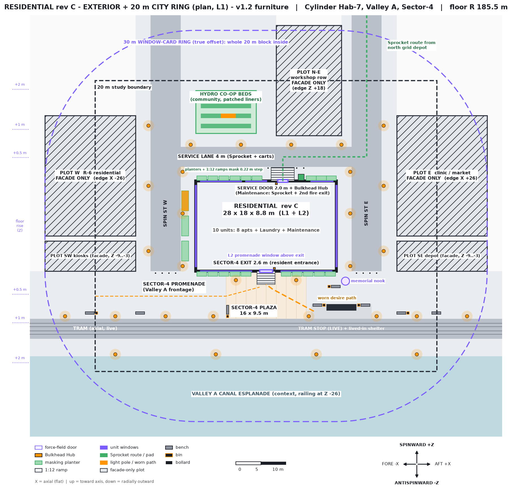

# Residential rev C — Exterior + 20 m City Ring (plan v1.3)

**Status: v1.3 (2026-10-30, Vance): memorial nook relocated for the monumental #29 (Jared's grander-memorial brief); everything else is APPROVED v1.2 by Jared 2026-10-29.** The plan PNG and the `.py` object table still show the v1.2 nook; Rook/Gage update them via the Grok Build CLI. The v1 design decisions are approved, and Jared thumbs-upped v1.1. This is design only. The v1 and v1.1 plan PNGs are kept for comparison. The build follows the asset list `residential_exterior_asset_list_v1.md`.
Generator: `design/residential_exterior_plan_v1.py` · Inputs: `cylinder_interior_overhaul_spec.md` and `residential_apartment_layout_v2.md` (rev C)

(For comparison: v1.1 `residential_exterior_plan_v1_1_plan.png`, v1 `residential_exterior_plan_v1_plan.png`)

## QC v1.3: memorial nook relocation (2026-10-30, Vance)
**Change:** the monument candidates (`design/assets/ext_memorial_monument/` report: 01 3.8 W × 1.01 D × 3.9 H, 4,512 tris; 02 3.6 × 1.6 × 4.3, 672; 03 3.64 × 1.2 × 3.97, 3,080; 04 3.9 × 1.2 × 4.1, 5,328; 05 3.6 × 1.22 × 3.8, 268; all pivot bottom-centre) do not fit the 1.6 × 1.6 m nook. In place (X 13.9..17.7) they would block the E sidewalk mouth (X 14..17 at Z -9) and sit 0.2 m from the building corner (14, -9).
**New nook:** X 17.4..21.6, Z -12.7..-9.6 (4.2 × 3.1 m) at the promenade end of Spin St E. Monument centred X 19.5, back face at Z -9.7, **rotated 180°** (model +Z → world -Z) to face the promenade/canal. Its footprint is X 17.55..21.45 at most (cand 04), and the front is at Z -10.7 to -11.3 (depth 1.0–1.6). Nook bench X 18.6..20.4, Z -12.7..-12.2 (faces the monument). Nook bin X 20.7..21.2, Z -12.7..-12.2. The old bench (13.0..14.8, -12.3..-11.8) and bin (12.3..12.8) are removed from there. Counts are unchanged (8 benches, 6 bins).
**Deviation from Rook's proposal:** Rook proposed Z -12.4 for the south edge. That leaves only 0.6 m between the bench and the front of the 1.6 m-deep candidate 02, so the edge moves to -12.7 to keep ≥ 0.9 m of standing room for every candidate.

| # | Check | Result | Numbers |
|---|---|---|---|
| 1 | Spin St E end bollards (Z -9.5..-9.3, X 17.9..22.1) | PASS | 0.1 m to the nook, 0.2 m to the monument back. The nook is south of the bollards, so cart blocking is unchanged. |
| 2 | E sidewalk mouth (X 14..17, Z -9) | PASS (improved) | The mouth is now fully clear. The nook starts 0.4 m east of it, beside the bollard row, which is not a walk line. |
| 3 | E outer sidewalk mouth (X 23..26) | PASS | 1.4 m clear walk between the nook (X 21.6) and X 23 (≥ 0.9). |
| 4 | Building footprint corner (14, -9) | PASS | 3.4 m to the nook (it was 0.2 m for the in-place monument). |
| 5 | Promenade through-walk (Z -15.4..-12.5) | NARROWED, PASS | Locally Z -15.4..-12.7 = **2.7 m** for X 17.4..21.6 (≥ 0.9). Everywhere else 2.9 m. |
| 6 | Tram shelter (X 12..18, Z -16.9..-15.6) and platform bench/bin (Z -16.05..-15.55) | PASS | 2.9 m from the shelter roof edge to the nook, and 2.65 m from the platform bench/bin. |
| 7 | Poles | PASS | The nearest are (16.75, -8), 1.6 m north-west across the bollards, and (22, -18), 5.3 m. None is inside the nook. |
| 8 | Planters / Tiered Steps (S wall to X 13.8, Z -10..-9.1) | PASS | 3.6 m west. |
| 9 | Sprocket route (Spin St E → lane → service ramp, all +Z) | PASS | No interaction. The route never enters the promenade. |
| 10 | Desire path (platform → exit ramp at X ±1.8) and plaza exit approach | PASS | Both are west of X 12. The nook is east of the platform's west half. |
| 11 | On walk zone | PASS | Inside the promenade (X -47..47, Z -18.5..-9). |
| 12 | Height | NOTE | At 3.8–4.3 m the monument is below the 5 m poles. It reads as the landmark at the Spin St E vista. |

## QC v1.2: street furniture (same object table and asserted checks; PNG checked with Read)
**Furniture placed:**
- **8 benches** (1.8 × 0.5 m):
  - 2 at the tram platform ends, beside the shelter.
  - 4 along the track-side edge of the promenade, facing the canal.
  - 1 at the west edge of the plaza.
  - 1 at the memorial nook (v1.3: moved to the nook's south edge, X 18.6..20.4, Z -12.7..-12.2).
- **6 bins**: 2 at the tram stop and one beside each of 4 benches (2 promenade, plaza, nook).
- **12 bollards**:
  - 4 across the end of each Spin Street at Z -9.4, which protects the promenade and plaza.
  - 2 + 2 along the lane-side edge of the north sidewalk, either side of the service ramp, separating lane from sidewalk.
- These match the asset list, so no counts changed.

| # | Check | Result | Note |
|---|---|---|---|
| 1 | Nothing in a road, lane or tram band | PASS | All 86 objects are on walk or green zones. There are 0 object-object overlaps and 0 off-map. |
| 2 | Walkways keep ≥ 0.9 m clear | FIXED | The bollards narrow the north sidewalk clear width from 1.5 to 1.1 m. Other widths: W 1.4, E 2.6, platform front 1.6 (now X 9..21), new promenade through-walk 2.9. |
| 3 | Exit approach, ramps and service door clear | PASS | The 2.6 m approach has no objects. The ramp-plus-apron box (X 0.5..6.0) is clear at 2.8 m deep. Furniture stays off both ramps. |
| 4 | Bollard gaps between 0.9 and 1.5 m (people pass, carts and vehicles don't) | PASS | Spin Street ends: 1.13 between bollards and 0.9 to the kerbs. Apron rows: 1.2. The 5.5 m ramp opening is the intended service access. |
| 5 | Sprocket (0.78 m) reaches the apron | PASS | The 5.5 m opening is well over 0.78, and the route lane → ramp → door is clear at a 0.9 m check width. |
| 6 | Walking routes | PASS | The desire path (platform → exit) and the promenade → exit route are both unobstructed. |
| 7 | Label collisions | FIXED | The plaza label moved off the plaza-edge bench, and the tram stop label moved into the tram band, off the poles and benches. The legend has 11 entries in the margin band. |
| 8 | Asset counts | PASS | Benches 8, bins 6, bollards 12, as in the asset list. Only the Where column was updated. |

## QC v1.1 checklist (geometry checked in the `.py`, which asserts every check; PNG checked with Read)
| # | Check | Result | Note |
|---|---|---|---|
| 1 | 30 m window-card ring is a true offset | PASS | It was already straight sides plus R 30 quarter arcs. The code confirms the offset error is 0.000 m. The 20 m box corner (34, 29) is 28.28 m from the footprint corner, so it is **inside** the ring. The plot extent covers the whole ring. |
| 2 | Hydro beds clear of Spin St W | FIXED | v1 beds ran to X -21, over the roadway. They now sit at X -14..-2 in a co-op yard that starts at X -17. No zones overlap. |
| 3 | Light poles never in a roadway | FIXED | v1 had poles in Spin St W and E (X ±17.4), the canal and the lane corner. All 30 v1.1 poles fall on walk surfaces, and the code finds 0 in road, lane or tram zones. |
| 4 | Label collisions and legend | FIXED | The memorial nook moved off the building edge into a promenade pocket. The legend, scale bar and compass now sit in a margin band below the map. The tram stop and desire-path labels were moved apart as well. |
| 5 | Plot edges match their labels | FIXED | W edge X -26, E edge +26, N-E edge Z +18, SW and SE Z -9..-3. These come from one zone table that drives both the geometry and the labels. Plots W/E start at Z -2, leaving a 1 m alley to SW/SE. Scale bar 10 m. |
| 6 | Tram shelter off the track | FIXED | The shelter is X 12..18, Z -16.9..-15.6, on the X 9..21 platform, with 1.6 m clearance to the track band. |
| 7 | Sensible walking routes | FIXED | Two routes reach the exit ramp: platform → diagonal desire path, and promenade (west) → plaza. Both are checked unobstructed at a 0.9 m width. The 2.6 m exit approach corridor is kept object-free. |
| 8 | Widths, connections, nothing blocking the exit | FIXED | Clear widths: W sidewalk 1.4, E 2.6, N 1.5, platform front 1.6, hydro aisles 1.1, kerb walk 2.9 (all ≥ 0.9). v1 ramps were only 0.9 m long (1:4), and v1.1 makes them 2.65 m (1:12). The exit ramp meets the plaza, the service ramp meets the lane, and the pad meets the sidewalk. The planters leave both ramps clear. |
| 9 | Orientation labels agree | PASS | +Z spinward, -Z antispinward, X axial with fore -X and aft +X. The plan compass now reads FORE -X / AFT +X, which matches the section and this doc. |
| 10 | Extra: Spin Streets crossed the pedestrian promenade and tram band | FIXED | The streets now end at the promenade (Z -9). Carts stay out of the plaza. |
| 11 | Extra: Plot SW/SE sat on the promenade, and contour ticks overlapped Plot W | FIXED | SW/SE are now at Z -9..-3, behind the promenade. The floor-rise ticks moved into the left margin. |
| 12 | Extra: Sprocket secondary route on the east sidewalk was redundant and crossed the nook | FIXED | Removed, because the exit hub is on the corridor side. The service route runs lane → ramp → door and is checked clear. |
| 13 | Extra: rectangle overlap audit | PASS | All ground zones (with only declared parent/child nesting) and all 60 objects (planters, ramps, pad, shelter, nook, beds, poles) were checked pairwise: 0 overlaps, 0 objects off a walk or green zone, 0 off-map. |
| 14 | Extra: asset counts | FIXED | Light poles 23 → 30 and platform kerb 7 → 6. The service apron is now the ramp. The tri total is about 209k. See the asset list. |
| 15 | Section PNG | PASS | Curvature numbers and labels are unchanged. It was regenerated from the same script. |

## Axis mapping and constants
- **The walking floor is at R = 185.5 m** (`R_HULL_FLOOR`). R 200 m is the hull/interior shell. The drum is 520 m long along world X, and the spin axis sits at Y 200, Z 0.
- **X is axial**: fore is -X, aft is +X. The floor is flat along X.
- **Z is circumferential**: spinward is +Z, antispinward is -Z. The floor curves only along Z.
- **Up** points toward the axis. **Down** points radially outward.
- The **Sector-4 promenade is on -Z** and faces the Valley A canal. The service side is on +Z.

## Curvature (rise = R(1 − cos(s/R)), tilt = s/R)
| Point (arc distance from building centre along Z) | Floor rise | Local "up" tilt |
|---|---|---|
| 9 m (building wall) | 0.22 m | 2.78° |
| 29 m (wall + 20 m, study edge) | **2.26 m** | **8.96°** |
| 39 m (30 m window-card ring) | 4.08 m | 12.05° |
| 20 m from the wall's own tangent | **1.08 m** | 6.18° |
| 1.7 m eye line meets floor at | **25.1 m** away | — |
| Axial (X) | 0 | 0° |

What this means on the ground:
- Neighbour buildings lean about 9° toward the player at the study edge.
- Past roughly 25 m along Z, the ground sits above eye level, so the horizon climbs overhead. The far side is 371 m straight up.
- Streets along X look flat. The Spin Streets, which run along Z, bowl upward.

## Approved decisions (Jared, 2026-10-29)
1. **Maintenance service door: confirmed.** It is 2.0 m wide, on the north (+Z) wall at X 3.2. It uses a force-field frame and a Bulkhead Hub, per the rev C door spec. It gives Sprocket exterior access and serves as the **2nd fire exit**. It opens onto a 1:12 service ramp, which doubles as the apron (X 1..5.6, Z 9..11.65). The exterior Sprocket pad sits flat beside it on the north sidewalk. This is noted in `residential_apartment_layout_v2.md`.
2. **Window streaming (handoff to Gage at rebuild):** windowed units keep the **real interior rendered out to 30 m**, and only then swap in the window card. This replaces the rev C "Cold > 20 m shows card" rule for windowed units. The whole 20 m block is inside the ring.
3. **The tram is live** and has a working stop. The shelter is still lived-in, as a story beat.
4. **Neighbour buildings are facade-only for now**: Plots W, E, N-E, SW and SE.
5. **The plinth is hidden.** The 0.22 m levelling step along both ±Z walls is masked by a run of planters plus 1:12 ramps at the Sector-4 exit and the service door. Each ramp is 2.65 m long for the 0.22 m rise, and the planters stop clear of both ramps. There is no visible plinth. The ±X walls need nothing, because there is no curvature along X.

## Zoning
- **South (-Z): the public face.**
  - The Sector-4 plaza (16 × 9.5 m) sits in front of the 2.6 m exit, with the L2 landing window above it.
  - A 9.5 m promenade runs along X, then the live tram (axial line, catenary), then the canal esplanade.
- **North (+Z): the service side.**
  - A 4 m service lane runs along X.
  - The apron and service door sit off the lane.
  - The hydro co-op beds and the workshop row are beyond the lane.
- **East and west (±X): the Spin Streets.** These are 3 m sidewalks plus 6 m Spin Streets running along Z, the curving direction.
  - The west sidewalk carries hydro planters.
  - The memorial nook sits in a promenade pocket at the end of Spin St E (v1.3: X 17.4..21.6, Z -12.7..-9.6; was X 15.0..16.6, Z -11.8..-10.2).
  - Facade-only neighbours sit beyond.

## Circulation
- **Residents:** they come from the tram platform diagonally across the plaza to the exit ramp, or along the promenade from the west to the same ramp. A worn desire path cuts diagonally across. The service door is the 2nd egress.
- **Sprocket:** it comes from the north grid depot down Spin St E, along the service lane, up the service ramp to the service door. It reaches the Sector-4 exit's Bulkhead Hub from inside, since that hub is on the corridor side. There is no exterior route to it. Carts never cross the plaza.
- **Promenade:** it runs continuously along X, links the neighbouring blocks, and is lit.

## Lighting
- There are 30 amber `#FF9500` poles, all on walk surfaces and never in a roadway, the lane or the tram band. They stand about every 10 m on the promenade's track-side edge, at the edges of the three building sidewalks, on the far side of the lane, on the outer sidewalks of the Spin Streets and on the canal kerb walk, plus two in the plaza at X ±6, clear of the 2.6 m exit approach.
- The dark gaps between poles let the lit windows read.
- The far-side city overhead provides the ambient light.

## Story and setting (wordless)
- **Aegis lived-in:** residents keep the block running.
  - The hydro beds are patched with amber tape and mismatched liners.
  - One west planter is dead.
- **Tram shelter:** the trams run, yet someone sleeps behind the timetable panel, with a bedroll and a hot plate.
- **Memorial nook:** wrist-RFID tags hang on a wire rack beside a violet field lamp and dried hydro flowers.
- **Wear:** the desire line across the plaza paving, scuffed kerbs at the stop, and Sprocket wheel tracks plus coupler scuffs on the apron and the service door jamb.
- **Coriolis tell:** litter and spills drift antispinward along the Spin Streets.

## Handoffs
- **Gage:** at rebuild time, change window streaming so windowed units keep real interiors to 30 m, then show the card (decision 2). Also add the service door as a navmesh link for Sprocket and as an egress.
- **Rook:** build to `residential_exterior_asset_list_v1.md`.

## Layout note — tram track shift (Atlas PM call, 2026-10-30 8:37 PM CT)
- Track centre moves 0.35 m toward the platform: **Z -20.25 -> Z -19.90** (rail module `ext_tram_rail_module.glb`, rotated 180°, X pitch 10 m). Car side (2.6 m wide) lands at Z -18.60 -> **~0.10 m platform gap**, no boarding sill.
- **Layout-script update needed** (`residential_exterior_plan_v1.py` "tram band" + rail placement): the 3.5 m module centred at -19.90 spans Z -18.15..-21.65, so its +Z 0.35 m runs under the kerb (#16, Z -18.5..-16.6, y 0..0.30). Resolve by either (a) a trimmed rail-module variant with the +Z edge at local z 1.40 (Rook can cut it), or (b) letting the kerb sit over the bed edge (kerb base would clip bed top y 0.19). Recommend (a).
- #18 catenary mast + wire span **CUT** (Atlas PM call; power is ground-fed via the centre power rail). Revivable by Jared. Remove catenary poles from the plan when the script is next run.
- **Update 8:48 PM CT (Atlas PM call, option a):** promoted `ext_tram_rail_module.glb` is now the trimmed 05 (10.0 × 3.146 × 0.20 m). Bed is asymmetric about the track: local +Z = platform side, and the track centre sits at **local z +0.177** from the bottom-centre pivot. Place with **rotation 0** (no 180° turn), origin at **Z -20.077** (track centre lands at Z -19.90), X pitch 10 m, y 0. World bed Z -21.65..-18.504 → 4 mm seam to the kerb front at Z -18.5 (kerbs stay rotated 180°, origins Z -17.55). Fit check: `design/assets/ext_tram_rail_module/ext_tram_rail_module_05_trim_kerb_fit.png`.
