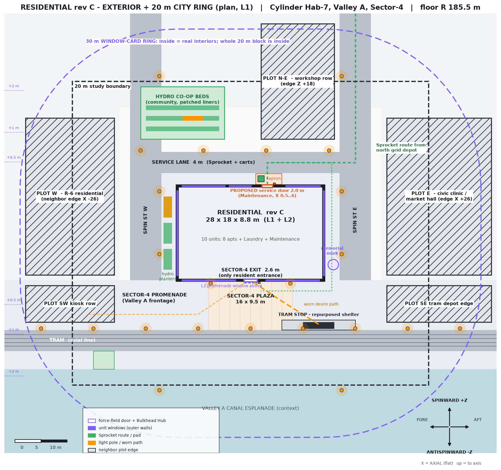
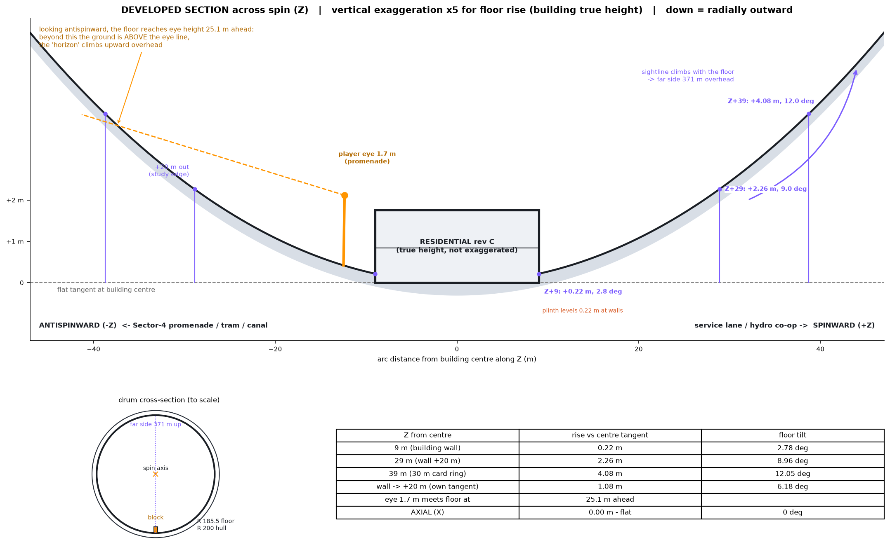

# Residential rev C — Exterior + 20 m City Ring (plan v1)

**Status: PLAN PENDING JARED APPROVAL. No modeling, no Godot or level work until Jared approves.**
Generator: `design/residential_exterior_plan_v1.py` · Inputs: `cylinder_interior_overhaul_spec.md` and `residential_apartment_layout_v2.md` (rev C)

## Axis mapping and constants
- **Walking floor is R = 185.5 m** (`R_HULL_FLOOR`, where every building is placed). R 200 m is the interior/hull shell radius and is not walked on. The drum is 520 m long along world X, and the spin axis is at Y 200, Z 0.
- **X is axial** (fore -X, aft +X). The floor does not curve along X, so it is flat.
- **Z is circumferential**: +Z is spinward and -Z is antispinward. The floor curves only along Z.
- **Up** points toward the spin axis, and **down** points radially outward.
- The **Sector-4 promenade is on -Z (antispinward)**, facing the Valley A canal. The service side is on +Z (spinward), behind Maintenance.

## Curvature (rise = R(1 − cos(s/R)), tilt = s/R)
| Point (arc distance from the building centre along Z) | Floor rise | Local "up" tilt |
|---|---|---|
| 9 m (building wall) | 0.22 m | 2.78° |
| 29 m (wall + 20 m, study edge) | **2.26 m** | **8.96°** |
| 39 m (30 m window-card ring) | 4.08 m | 12.05° |
| 20 m measured from the wall's own tangent | **1.08 m** | 6.18° |
| 1.7 m eye line meets the floor at | **25.1 m** away | — |
| Axial (X), any distance | 0 | 0° |

**What this means:**
- The rigid 18 m slab sits on a **levelling plinth that varies by 0.22 m** at the ±Z walls.
- Neighbour buildings at the study edge lean about 9° toward us.
- Past about 25 m spinward or antispinward, the ground sits *above* the eye line, so the horizon climbs overhead. The far side of the drum is 371 m directly up.
- Streets along X look dead flat. Streets along Z visibly bowl upward. This asymmetry is the main way the player reads the cylinder.

## Zoning
- **South (-Z): the public face.**
  - The Sector-4 plaza (16 × 9.5 m) sits in front of the only resident entrance, the 2.6 m Sector-4 exit. The L2 landing window looks down on it.
  - A 9.5 m promenade runs along X, then the tram line (axial, which suits a drum with no curvature along X), then the Valley A canal esplanade.
- **North (+Z): the service side.**
  - A 4 m service lane runs along X.
  - A **proposed 2.0 m service door** on the north wall of Maintenance (X 3.2) opens onto an apron with a Sprocket pad.
  - The hydro co-op beds and the workshop row sit beyond the lane.
- **East and west (±X): 3 m side walks plus 6 m "Spin Streets" running along Z**, the curving streets. Beyond them are neighbour plots: W is R-6 residential and E is a civic clinic and market hall. The kiosk row and the tram depot edge sit at the promenade corners.
- The block keeps public space small, in line with rev C. The plaza is the only open space. Everything else is street, frontage, or growing beds.

## Circulation
- **Residents:** tram stop → plaza → Sector-4 exit. A worn diagonal desire path cuts across the plaza. A second path runs from the kiosks along the promenade.
- **Sprocket and service:** Sprocket comes down Spin St E from the north grid depot, along the service lane, to the apron and the Maintenance service door (2.0 m, Bulkhead Hub). A secondary route runs down the east side walk to the Sector-4 exit for coupler-socket calls. Carts never cross the plaza.
- **Promenade:** continuous along X and lit, linking the neighbouring blocks.

## Lighting
- Amber `#FF9500` poles about every 10 m along the promenade, 12 m along the service lane, and at Spin Street corners, plus two poles flanking the exit.
- Pools of light are kept between the poles so the lit unit windows read as the main glow.
- Overhead, the far-side city provides the ambient "sky".

## Window-card rule
- Unit windows (violet on the plan) keep the **real interior until the player is 30 m away**.
- The 30 m ring encloses the **whole 20 m block**, so from anywhere on this block every window must show its real interior. Cards only appear from the canal or the far streets.
- ⚠ This conflicts with rev C streaming, where Cold means more than 20 m and shows a window card. See open questions.

## Story and setting (wordless)
- **Aegis lived-in:** people still run the block after whatever happened. Hydro beds are patched with amber tape and mismatched liners (one bed is visibly re-lined). The planter by Spin St W has a dead bay.
- **The repurposed tram shelter** has bedding and a hot plate tucked behind the timetable panel. The trams still run, but someone lives here.
- **The memorial nook** at the SE corner holds wrist-RFID tags hung on wire, a violet field lamp, and dried hydro flowers. It ties in with the RFID door story without any words.
- **Worn paths:** the desire line across the plaza paving, scuffed kerbs at the tram stop, and Sprocket wheel tracks plus coupler scuffs on the service apron and door jamb.
- **Coriolis tell:** spilled water and loose litter drift antispinward along the Spin Streets.
- **Overhead:** the far-side city over the plaza sells the scale. The L2 landing window frames it.

## Open questions for Jared
1. **Service door:** may I add the 2.0 m exterior service door to Maintenance (north wall, X 3.2)? Rev C currently has only the Sector-4 exit. It would also act as a second fire exit.
2. **Streaming conflict:** interiors unload at 20 m, but the window-card rule keeps real interiors to 30 m. Which governs? I'd suggest keeping interiors Warm and windows-only out to 30 m.
3. **Tram:** is the tram live (moving, with a stop) or a dead line with a repurposed shelter? The plan assumes live.
4. **Neighbour plots:** should these be facade-only edges, or will any become enterable later?
5. **Plinth:** a visible 0.22 m stepped plinth, or hide the difference with ramps and planters?
