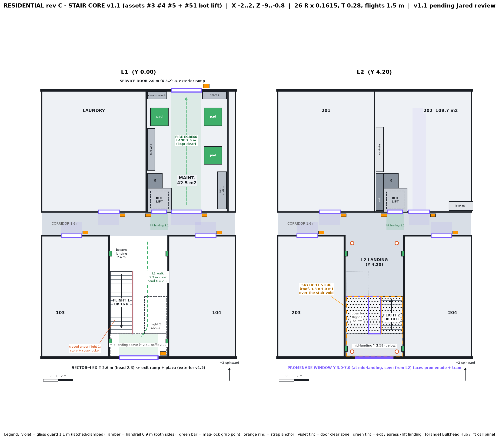
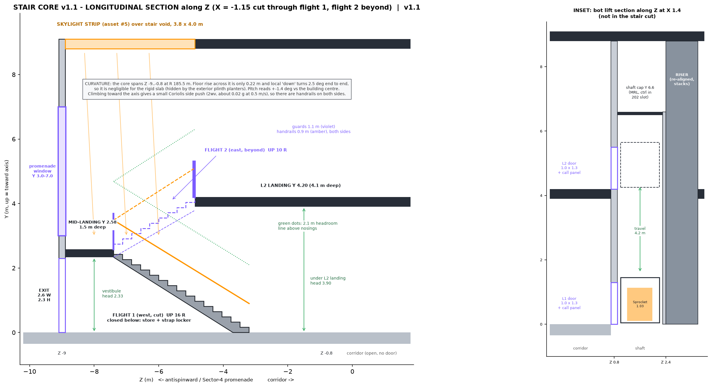

# Residential rev C — Stair Core v1 (assets #3, #4, #5)

**Status: APPROVED arrangement; v1.1 lift + skylight pending Jared review.** This is design only. The v1 PNGs are kept for comparison (`residential_stair_core_v1_plan.png`, `_section.png`).
Generator: `design/residential_stair_core_v1.py`, which asserts the QC checks below.
Scope, from `residential_asset_list_rev_c.md`:
- **#3** switchback stair set (2 flights + landings), 4.0 × 8.2 m, 4.2 m rise
- **#4** stair glass + handrail (own collider), about 12 m run, 1.1 m high
- **#5** skylight strip, stair core roof

## Conflict: preface atrium stair vs rev C switchback
| | Preface spec (`preface_playable_residential_sector_spec.md` §3) | Rev C (`residential_apartment_layout_v2.md`) |
|---|---|---|
| Form | 3.0 m wide open switchback inside a 12 × 5 m open atrium lightwell, mezzanine gallery, overlook window | Enclosed 4.0 × 8.2 m core, two 1.5 m flights, no lobby, atrium or void |
| Footprint | Two 3.0 m flights need about 6.8 m of width plus the 60 m² void | Fits the 4.0 m core |
| Public space | Large (contradicts the rev C brief) | About 65 m² per floor (13%) |
| Tris | Atrium glass, mezzanine and balustrade add an estimated 8–12k | ≤ 12k per floor for shell, corridor and core together |
| Spin-down | Long open drops, with glass edges along a 12 m void | Short flights and walls on both sides, so handrails reach everywhere |
| Fire egress | The open void spreads smoke to L2 | Compact core, short travel, with a second L1 exit at the service door |

**Recommendation: keep the rev C switchback,** and bring in the atrium's best ideas:
- The **skylight + light-well**: a 3.8 × 4.0 m skylight strip over the stair void, with light falling through the 0.8 m central well to the L1 vestibule.
- The **mid-landing overlook window**: this becomes the promenade window.
- **Signal-orange `#D95B26` nosing strips** and **cyan stringer LEDs**, which double as battery-backed emergency lighting.

## Design finding: the rev C text did not close the circulation loop (fixed here)
- **The problem:** rev C described the mid-landing "at the north end" with the L2 top landing at the south. With two side-by-side flights, the L2 arrival is at the same end as the L1 start. That put the L2 arrival at the south, with no floor linking it to the L2 corridor at Z -0.8. It also left a 2.1 m landing over the L1 corridor opening, leaving only about 1.85 m headroom under it.
- **v1 arrangement:**
  - Flight 1 (west) starts at L1 by the corridor and rises south.
  - The **mid-landing is at the south end, Y 2.58**, over the exit vestibule.
  - Flight 2 (east) rises north and arrives at a **4.1 m deep L2 landing that opens straight onto the L2 corridor**.
  - L1 residents walk under flight 2 to the exit.
- **Why the flights are unequal (16 + 10 risers):** the mid-landing soffit (2.33 m) has to clear the 2.3 m exit door head and give more than 2.1 m vestibule headroom.
- **The promenade window** is a tall slot on Z -9 at the mid-landing (Y 3.0–7.0). It is still "above the exit" as on exterior v1.2, and it is seen from flight 2 and across the void from the L2 landing.

## Geometry (computed in the .py)
| Item | Value | Rule |
|---|---|---|
| Risers | **26 × 0.1615 m** = 4.20 m (flight 1: 16, flight 2: 10) | ≤ 0.17 ✓ (rev C's 24 × 0.175 was over the limit) |
| Tread | **0.28 m**; 2R + T = 0.603; pitch 30.0° | ≥ 0.28 ✓, 0.60–0.64 ✓ |
| Flights | 1.5 m wide, 1.3 m clear between handrails; central well 0.8 m | ≥ 0.9 ✓ |
| Runs | Flight 1: 15 T = 4.20 m; flight 2: 9 T = 2.52 m | — |
| Mid-landing | Z -8.9..-7.4 (1.5 m deep), Y 2.585, soffit 2.335 | depth ≥ flight width ✓ |
| Fit along Z (8.1 m clear) | 1.5 landing + 4.20 run + 2.40 bottom landing = **8.10 m** ✓ | fits exactly |
| L2 side | 1.5 + 2.52 + **4.08 m L2 landing** = 8.10 m ✓ | — |
| Headroom | ≥ **2.93 m** over every nosing; L1 walk ≥ **2.33 m**; under L2 landing 3.90 m | ≥ 2.1 m (Patch's REAL-04) ✓ |
| Guards / handrails | Glass guards 1.1 m at the well, the landing edges and the L2 edge; handrails 0.9 m on both sides of both flights | ✓ |
| Exit door | 2.6 W × 2.3 H on Z -9, with a 2.6 × 1.5 m clear zone inside | head ≤ soffit 2.335 ✓ |
| Curvature | 0.22 m floor rise across the core, 2.5° change in "down" end to end | negligible; the slab is level and the step is hidden by the exterior planters |

## Spin-down safety
- **Glass:** laminated glass in clamped patch fittings, with latch pins at each landing so panels can't release in a spin transient. The guards and rails get their own colliders (REAL-02).
- **Handrails:** continuous on both sides of both flights, and they don't break at the mid-landing. Both sides also matters because climbing toward the axis gives a Coriolis side push of about 0.02 g.
- **Mag-lock grab points:** at the bottom landing, the mid-landing and the L2 landing, on both walls (green on the plan).
- **Emergency strap anchors:** 4 at the L2 landing and 2 at the mid-landing (orange rings). A strap locker sits in the closed store under flight 1.
- **Lighting:** the nosing strips, stringer LEDs and exit sign run on a 90-minute battery backup.

## Sprocket
Sprocket **cannot climb stairs**. Its routes stay on L1:
- Maintenance pads
- Corridor door hubs, including the Sector-4 exit hub on its inside jamb
- The exterior service ramp

L2 services run through the **riser chase** (Maintenance → the sealed chase in 202).
- **Open question:** who services the coupler sockets on the L2 door hubs?
- **Story tie:** Sweep is "stuck" in 204 on L2. The fact that bots can't use the stair already tells that story without words.
- **Lift option:** a 1.2 × 1.2 m bot lift is possible only by taking about 1.5 m² from Maintenance or 202. Flagged below, not proposed by default.

## Ties
- **Exterior v1.2:** the Sector-4 exit (Z -9, X 0, 2.6 m) opens onto the 1:12 exit ramp and the plaza. The promenade window faces the promenade and the live tram stop. The skylight strip sits on the roof over Z -8.9..-4.88 and should be added to the roof plan when the roof is drawn.
- **Rev C corridor doors:** the core opens to the corridor at Z -0.8 with no door.
  - Door clear zones (door width × 0.9 m) are checked free: 103 and 104 at X ±4.5 (Z -0.8), Laundry at X -2 and Maintenance at X 3.2 (Z +0.8) on L1; 203, 204, 201 and 202 on L2.
  - The flight 1 bottom landing (2.4 m) and the L2 landing (4.1 m) don't block any of them.

## QC checklist (asserted in the .py; PNGs checked with Read)
| # | Check | Result |
|---|---|---|
| 1 | Risers ≤ 0.17, tread ≥ 0.28, 2R+T in range, 26 risers = 4.2 m | PASS |
| 2 | Flights and landings fit 8.1 m clear; landing depths ≥ flight width | PASS |
| 3 | Headroom ≥ 2.1 m over flights (min 2.93) and over the L1 walk and exit zone (min 2.33) | PASS |
| 4 | Exit door head 2.3 ≤ mid-landing soffit 2.335 | PASS (it failed with equal 13/13 flights, so fixed with 16/10) |
| 5 | No solids inside the exit, walk, bottom landing, core opening or door clear zones | PASS (the wall grab rail is measured to the rail face) |
| 6 | All clear walks ≥ 0.9 m (flights 1.3, L1 walk 2.3, exit 2.6) | PASS |
| 7 | No overlaps among solid objects | PASS |
| 8 | Labels | PASS (Read on both PNGs; leaders for the under-stair store and skylight notes) |

## v1.1 decisions (Jared, 2026-10-29)
1. **APPROVED:** the corrected switchback (south mid-landing, 16/10 flights, 26 × 0.1615 m risers, window at the mid-landing). `residential_apartment_layout_v2.md` (text, ASCII, tables) and asset list items #3 and #4 are updated to match.
2. **Skylight #5 shrinks to 3.8 × 4.0 m**, over the stair void only (Z -8.9..-4.88). Updated in the asset list.
3. **ADD a 1.2 × 1.2 m Sprocket bot lift serving L1 and L2.** Added as asset #51. Placement is below.
4. **No smoke curtain.** It is removed from the open questions.

## Bot lift placement
The shaft is 1.6 × 1.6 m gross: a 1.4 × 1.4 m clear well holds the 1.2 × 1.2 m car with 0.1 m running clearance. It runs through both levels, so it has to fit at the same XZ inside Maintenance (L1, faces X 0.6..5.9) **and** inside 202 (L2, faces X 0.1..13.9).

| Option | Placement | Pros | Cons |
|---|---|---|---|
| **1 (recommended)** | SW corner, X 0.6..2.2, Z 0.8..2.4, door onto the corridor at both levels. The riser is re-aligned directly north of it (X 0.6..1.6, Z 2.4..3.4). | Services stack (riser + lift + controller in one SW chase). It **fixes an existing fault**: the L1 riser (X 0.7..1.7, Z 1..2) and the L2 chase (X 0..1, Z 0.8..1.8) were 0.7 m out of line, so they could not have been one shaft. The lift opens onto the public corridor, so Sprocket never enters 202. It sits 1.5 m from the Maintenance door. | 202 also loses a 0.5 m sliver west of the shaft, sealed as the lift-controller slot. The 202 wardrobe moves 0.5 m north. |
| 2 | East of the Maintenance door, X 4.3..5.9, Z 0.8..2.4, corridor doors | 202 only loses 2.56 m² with no sliver | Not stacked with the riser. The substation has to move. The 202 kitchen counter shifts about 1 m. The riser misalignment still needs a separate fix. |
| 3 | SW corner as option 1, with a through-car (L1 door into Maintenance, L2 door onto the corridor) | Sprocket rides straight from the pads | Needs a 1.2 m landing inside Maintenance, which pushes the tool wall and a pad. Two door types. |

**Area lost (option 1):**
- **Maintenance L1:** the 2.56 m² shaft, so 45.1 → **42.5 m²**. The riser just moves within the room, so its area is unchanged.
- **202 L2:** the 2.56 m² shaft, plus 1.0 m² for the re-aligned riser and 1.56 m² for the controller slot, minus the old 1.0 m² chase, which is returned. Net loss is 4.1 m², so 114.8 → **109.7 m²** (still the largest north unit along with 201).

**Kept clear in Maintenance:**
- A straight **2.0 m fire-egress lane (X 2.2..4.2)** runs from the corridor door to the north service door. In v1 this path was blocked: the pads at X 2.2..3.4 sat in it and left only a 0.8 m gap.
- The re-planned pads are at X 0.8..2.0 / Z 6.6..7.8 and X 4.4..5.6 / Z 4.0..5.2 and 6.6..7.8. Each is within 0.3 m of the lane.
- The substation stays at X 5.3..5.9, Z 1.0..3.5. The tool wall is at Z 3.6..6.4, the spares shelf at X 4.3..5.9, and the coupler mounts stay on the north wall.

**Landings:**
- L1 and L2 landings are 1.2 × 1.2 m in the corridor (Z -0.4..0.8, X 0.8..2.0).
- They are checked clear of the Laundry, Maintenance and 202 door zones and of the stair-core opening.
- The call panel is on the west jamb, Bulkhead Hub style.
- The shaft cap is at Y 6.6. The lift is machine-room-less, with its controller in the 202 slot.

## QC v1.1 (asserted in the .py; PNGs checked with Read)
| # | Check | Result |
|---|---|---|
| 1 | All v1 stair checks (risers, tread, fit 8.1 m, headroom 2.93 / 2.33, door head, clear zones, overlaps) | PASS (re-run) |
| 2 | Maintenance solids: no overlaps; none in the egress lane, the lift landing or the corridor door zones | PASS (FIXED: pads moved out of the lane) |
| 3 | L2 solids (shaft, riser chase, controller slot, moved wardrobe, kitchen) don't overlap and stay out of the lift landing, the 202 entry path and the 202 door zone | PASS |
| 4 | Lift landings ≥ 1.2 × 1.2, door ≥ 0.98 (Sprocket 0.78 + 0.2), car 1.2 with 0.1 clearance | PASS |
| 5 | Shaft and riser at the same XZ inside Maintenance and 202; the riser touches the shaft | PASS (FIXED: old riser misalignment) |
| 6 | Egress lane 2.0 m, straight door-to-door; every pad within 0.3 m of it | PASS |
| 7 | Lift landings clear of the core opening and the 202, Laundry and Maintenance door zones | PASS |
| 8 | Labels: unit labels backed, the service-door hub moved outside (it overlapped the coupler mounts), the lift inset sits beside the section | FIXED |

## Open questions for Jared
1. Approve **option 1** (SW corner, corridor doors, riser re-aligned) and the **Maintenance re-plan** for the egress lane?
2. The 202 net area becomes 109.7 m². Is that acceptable, or should the controller slot go elsewhere (it could sit at the roof with a machine-on-top lift)?
3. The rev C room-layout PNGs (`residential_roomlayout_rev_c_*.png`) still show the old pads, riser and wardrobe. Should I regenerate them after approval?
